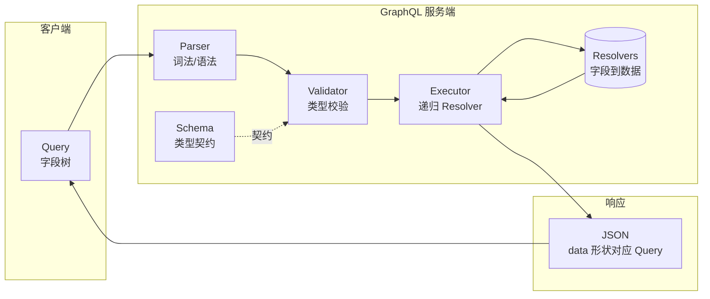
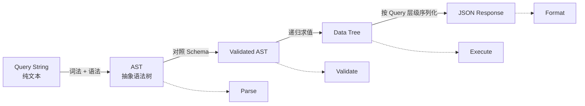

大多数后端开发者对 GraphQL 的第一印象是「一个更灵活的 REST」——客户端能自选字段、避免冗余。但这只是入口。GraphQL 更关键的变化，是让服务端通过 Schema 声明可用能力，让客户端用 selection set 组合本次响应；执行器再按这棵字段树调度 Resolver。

沿着这条主线，片段（Fragment）、指令（Directive）、订阅（Subscription）以及 DataLoader 等机制就不再是孤立概念，而是分别作用于字段收集、执行和数据访问的工程能力。

> 本文示例基于 `graphql-js` 16.x 与 Node.js 20+。核心概念对任何语言的实现（graphql-go / graphql-java / async-graphql 等）通用。

---

## 一、先建立心智模型：Schema 是契约，Query 是响应的形状

在典型 REST API 里，请求方法与 URL 表达操作，响应字段主要由服务端决定。GraphQL 则把字段选择交给客户端：

- **服务端声明「能查什么」**——通过 Schema 定义类型、字段和关系，并实现取数、权限等规则。
- **客户端决定「实际要什么」**——通过 Query 挑选字段树。
- **成功响应里 `data` 的结构与实际执行的 selection set 对应**。

更精确地说，`data` 会按 Query 的 selection set 组织；如果 Resolver 抛错或触发 `Non-Null` 冒泡，相关分支可能变成 `null`，具体失败位置会出现在 `errors[].path` 里。



一句话概括：**GraphQL 引擎是一个「由 selection set 驱动、受 Schema 约束的字段执行器」**。数据可以来自 MySQL、Redis、微服务或文件，具体访问方式由 Resolver 和数据访问层负责。

---

## 二、查询处理的四阶段流水线

任何一条 GraphQL 查询，在服务端通常都会走完这四步：



| 阶段 | 输入 | 输出 | 核心工作 |
|------|------|------|----------|
| **Parse** | Query 字符串 | AST | 词法分析（Lexer）+ 语法分析（Parser） |
| **Validate** | AST + Schema | 已校验 AST | 字段是否存在、参数类型是否匹配、片段循环检测 |
| **Execute** | 已校验 AST + Resolvers | 数据树 | 按字段树递归求值；同层 query 字段通常并行，mutation 根字段串行 |
| **Format** | 执行结果 | JSON | 序列化 `data` / `errors` / `extensions`，保持响应层级 |

严格说，GraphQL 规范的核心算法是 Parse / Validate / Execute。这里把 Format 单独列出来，是为了把服务端框架最后生成 HTTP/JSON 响应的动作也纳入流水线。

理解这四步后，再阅读不同 GraphQL 服务端框架的执行入口会容易得多。

---

## 三、最小可运行示例：一个完整闭环

先动手跑一遍再讲原理，比反过来学得快得多。

```bash
mkdir gql-demo && cd gql-demo
npm init -y
npm install graphql
npm pkg set type=module
```

```javascript
// server.mjs —— GraphQL 查询处理的最小闭环
import { graphql, buildSchema } from 'graphql';

/**
 * 1) 定义 Schema
 *    Schema 是 GraphQL 的「契约」：客户端能看到什么、服务端能提供什么，
 *    都以它为唯一真源（Single Source of Truth）。
 */
const schema = buildSchema(`
  type User {
    id: ID!
    name: String!
    posts: [Post!]!
  }
  type Post {
    id: ID!
    title: String!
    author: User!
  }
  type Query {
    user(id: ID!): User
    posts: [Post!]!
  }
`);

/**
 * 2) 模拟数据源
 *    真实场景可能是 MySQL / Redis / 远端 RPC / 甚至多个上游聚合。
 *    GraphQL 引擎完全不关心数据从哪来。
 */
const db = {
  users: {
    '1': { id: '1', name: 'Alice' },
    '2': { id: '2', name: 'Bob' },
  },
  posts: [
    { id: 'p1', authorId: '1', title: 'GraphQL 入门' },
    { id: 'p2', authorId: '1', title: 'Resolver 详解' },
    { id: 'p3', authorId: '2', title: '类型系统设计' },
  ],
};

/**
 * 3) Resolver: 告诉引擎「每个字段怎么取」
 *    嵌套字段常用函数（惰性求值）——只有客户端 query 到时才执行。
 */
const rootValue = {
  /**
   * 根字段: 按 id 查用户
   * @param {{ id: string }} args - 查询参数
   * @returns {object|null} 用户对象；posts 字段是惰性函数
   */
  user: ({ id }) => {
    const u = db.users[id];
    if (!u) return null;
    return {
      ...u,
      posts: () => db.posts.filter(p => p.authorId === id),
    };
  },
  /**
   * 根字段: 所有文章
   * @returns {Array<object>} 文章列表，每篇附带 author 惰性解析
   */
  posts: () => db.posts.map(p => ({
    ...p,
    author: () => db.users[p.authorId],
  })),
};

/**
 * 4) 客户端查询: 只索要需要的字段（减少 over-fetching / under-fetching）
 */
const query = `
  query GetUserWithPosts {
    user(id: "1") {
      name
      posts { title }
    }
  }
`;

/**
 * 5) 执行: graphql() 内部完成 parse → validate → execute，并返回可序列化的结果
 */
const result = await graphql({ schema, source: query, rootValue });
console.log(JSON.stringify(result, null, 2));
```

运行 `node server.mjs`：

```json
{
  "data": {
    "user": {
      "name": "Alice",
      "posts": [
        { "title": "GraphQL 入门" },
        { "title": "Resolver 详解" }
      ]
    }
  }
}
```

**关键观察**：响应里没有 `id`、没有 `author`——因为客户端没要。响应的形状与 Query 的形状**逐字段对应**。

---

## 四、Parse 阶段：字符串如何变成 AST

Parse 与你熟悉的 JS/TS 编译器前端一模一样——先词法，再语法。

**词法（Lexer）** 把字符流切成 Token：

```
"query { user(id: \"1\") { name } }"
      ↓
[QUERY] [BRACE_L] [NAME:user] [PAREN_L] [NAME:id] [COLON] [STRING:1] [PAREN_R] [BRACE_L] [NAME:name] [BRACE_R] [BRACE_R]
```

**语法（Parser）** 按 GraphQL 语法规则把 Token 流构造成 AST：

```javascript
/**
 * 观察 Parse 阶段的产出
 * 直接调用 graphql-js 底层的 parse，不涉及 Schema
 */
import { parse } from 'graphql';

const ast = parse(`
  query GetUser {
    user(id: "1") { name }
  }
`);

console.log(JSON.stringify(ast, null, 2));
```

节选输出（结构非常规整）：

```json
{
  "kind": "Document",
  "definitions": [{
    "kind": "OperationDefinition",
    "operation": "query",
    "name": { "kind": "Name", "value": "GetUser" },
    "selectionSet": {
      "kind": "SelectionSet",
      "selections": [{
        "kind": "Field",
        "name": { "value": "user" },
        "arguments": [{
          "kind": "Argument",
          "name": { "value": "id" },
          "value": { "kind": "StringValue", "value": "1" }
        }],
        "selectionSet": {
          "selections": [{ "kind": "Field", "name": { "value": "name" } }]
        }
      }]
    }
  }]
}
```

**要点**：Parse 只关心语法合法性，**完全不看 Schema**。你写 `user(id: "1") { xxxNotExist }` 也能 parse 成功——这个错误由下一阶段抓。

---

## 五、Validate 阶段：AST 与 Schema 的类型握手

Validate 用一组 **规则集（Validation Rules）** 遍历 AST，把每个字段/参数/片段与 Schema 对齐：

```javascript
/**
 * 观察 Validate 阶段
 * 传入错误的字段名，看引擎返回什么
 */
import { parse, validate, buildSchema } from 'graphql';

const schema = buildSchema(`
  type Query { user(id: ID!): User }
  type User { name: String! }
`);

const badAst = parse(`{ user(id: "1") { nam } }`); // nam 是拼写错误
const errors = validate(schema, badAst);
console.log(errors.map(e => e.message));
// [ 'Cannot query field "nam" on type "User". Did you mean "name"?' ]
```

内置规则涵盖：
- **字段存在性**：`Cannot query field "nam" on type "User"`
- **参数类型**：例如把布尔值传给 `ID!`，会得到 `ID cannot represent a non-string and non-integer value: true`
- **必填参数**：`Field "user" argument "id" of type "ID!" is required`
- **片段循环**：防止 `fragment A on X { ...B }` + `fragment B on X { ...A }` 无限递归
- **变量使用**：声明的 `$foo` 必须被用到，且类型匹配

需要注意，Validate 只能检查文档本身。下面的查询可以通过静态校验，因为 `$id` 的声明类型与使用位置兼容；请求传入的实际变量值要到执行准备阶段才能转换：

```graphql
query GetUser($id: ID!) {
  user(id: $id) { name }
}
```

如果 `variables` 是 `{ "id": true }`，执行字段前就会返回 `Variable "$id" got invalid value true`。因此，**Validate 通过只表示查询文档在静态结构上与 Schema 对齐**，不代表本次请求的运行时输入一定有效。

进入 Execute 后，引擎还要选择 operation、转换变量和参数、调用 Resolver、序列化标量、完成 list / non-null 值、解析 interface / union 的具体类型，并在出错时按空值传播规则生成 `data` 和 `errors`。

---

## 六、Execute 阶段：递归调度 Resolver

这是 GraphQL 的心脏。下面的迷你执行器只保留「遍历字段、解析字段值、递归完成子选择集」这副骨架，帮助理解控制流；它不是 GraphQL 规范执行器的替代实现。

```javascript
/**
 * 迷你 GraphQL 执行器: 演示 Execute 阶段的核心递归
 * @param {object} selection - 已解析的字段选择(AST 简化版)
 * @param {object} resolvers - 当前层的字段名 → resolver 函数
 * @param {*}      parent    - 上一层字段返回的对象，作为下层 resolver 的 source
 * @param {object} context   - 请求级共享上下文
 * @returns {Promise<object>} 按 selection 形状组装出的数据
 */
async function execute(selection, resolvers, parent = null, context = {}) {
  const fields = Object.entries(selection).map(async ([responseKey, sub]) => {
    const fieldName = sub.field ?? responseKey;

    // 模拟 graphql-js 的默认字段解析：读取同名属性；如果是函数则调用它。
    const defaultResolver = (source, args, ctx) => {
      const property = source?.[fieldName];
      return typeof property === 'function'
        ? property.call(source, args, ctx)
        : property;
    };

    const resolver = resolvers[fieldName] ?? defaultResolver;
    const value = await resolver(parent, sub.args ?? {}, context);

    if (!sub.children || value == null) {
      return [responseKey, value];
    }

    const completed = Array.isArray(value)
      ? await Promise.all(value.map(item =>
          item == null ? null : execute(sub.children, {}, item, context)))
      : await execute(sub.children, {}, value, context);

    return [responseKey, completed];
  });

  return Object.fromEntries(await Promise.all(fields));
}

/**
 * 模拟一条已经 parse+validate 完的 query:
 *   { user(id: "1") { name, posts { title } } }
 */
const selection = {
  user: {
    args: { id: '1' },
    children: {
      name: {},
      posts: { children: { title: {} } },
    },
  },
};

const resolvers = {
  user: (_parent, { id }) => ({
    name: 'Alice',
    posts: [{ title: 'GraphQL 入门' }, { title: 'Resolver 详解' }],
  }),
};

console.log(JSON.stringify(await execute(selection, resolvers), null, 2));
```

真实的 `graphql-js` 执行器还会处理：

1. **字段收集**：处理 alias、Fragment、`@skip` / `@include`，并按 response key 合并字段。
2. **值完成**：等待 Promise，序列化标量，递归处理对象、列表、interface 和 union。
3. **执行顺序**：Query 的兄弟字段可以并发完成；只有 Mutation 的顶层字段按文档顺序串行执行，嵌套字段仍按普通规则执行。
4. **错误传播**：可空字段失败时在当前位置返回 `null`；非空字段失败时向最近的可空父级冒泡。
5. **上下文传递**：使用 `(parent, args, context, info)` 签名，`context` 通常保存认证信息和 DataLoader 实例。

这也是为什么 GraphQL 的错误响应可能同时包含 `data` 和 `errors`：仍然有效的分支可以出现在 `data` 中，失败位置通过 `errors[].path` 标出；如果失败字段是 `Non-Null`，`null` 会继续向上冒泡到最近的可空父字段。

### Non-Null 是怎样冒泡的

假设 `Query.user` 可空，而 `User.name` 非空：

```graphql
type Query { user: User }
type User { name: String! }
```

如果 `user` Resolver 返回 `{ name: null }`，`name` 不能保留为 `null`，错误会使整个 `user` 分支变成 `null`：

```json
{
  "data": { "user": null },
  "errors": [{
    "message": "Cannot return null for non-nullable field User.name.",
    "path": ["user", "name"]
  }]
}
```

如果 `Query.user` 也是 `User!`，冒泡会继续到根节点，此时整个 `data` 为 `null`。Non-Null 表达的不只是「这个字段通常有值」，还决定了运行时错误可以影响多大的响应范围。

---

## 七、Resolver 的完整签名：`(parent, args, context, info)`

生产项目通常会按类型组织 Resolver。下面是 Apollo Server、GraphQL Yoga、GraphQL Tools 等工具常见的 Resolver Map 形状；它需要由相应框架绑定到 Schema，并不是把对象声明出来就会自动生效。JavaScript 函数不要求显式声明所有参数，可以只保留实际使用的参数。

```javascript
/**
 * 完整签名的 Resolver
 * @param {*} parent - 父字段返回的对象（顶层字段是 rootValue）
 * @param {object} args - 客户端传入的参数，已按 Schema 类型转换
 * @param {object} context - 每次请求的上下文（认证/DB 连接/DataLoader）
 * @param {object} info - 当前字段的 AST 与执行元信息（高级用法）
 */
const resolvers = {
  Query: {
    user: async (_parent, { id }, ctx, _info) => {
      if (!ctx.user) throw new Error('Unauthorized');
      return ctx.db.user.findUnique({ where: { id } });
    },
  },
  User: {
    // 嵌套 Resolver: parent 就是 User 对象
    posts: async (user, _args, ctx) => {
      return ctx.loaders.postsByUser.load(user.id); // DataLoader 批量取
    },
  },
};
```

**context 是跨 Resolver 共享请求级状态的标准通道**。认证信息、请求级 DataLoader 和追踪信息适合放在这里；不要把请求相关的可变状态放进模块级全局变量，否则并发请求可能互相污染。

---

## 八、N+1 问题与 DataLoader

这是 GraphQL 生产环境很常见的坑。看这条查询：

```graphql
{
  posts {         # 1 次 SQL: SELECT * FROM posts
    title
    author {      # N 次 SQL: 每篇 post 一次 SELECT * FROM users WHERE id=?
      name
    }
  }
}
```

100 篇文章 = **1 + 100 = 101 次数据库查询**。这就是 N+1 问题的由来——GraphQL 的字段递归如果照着每个关系字段单点查，很容易展开成大量小查询。

常见解决方案是 [DataLoader](https://github.com/graphql/dataloader)：**收集同一批次中的 `.load(id)` 调用，合并成一次批量查询，并在当前请求内缓存相同 key 的结果**。它不是唯一方案；SQL join、ORM relation preload、查询规划器或上游批量 API 也可以从数据访问层消除 N+1。

```javascript
import DataLoader from 'dataloader';

/**
 * 为每次请求创建独立的 DataLoader（避免跨请求缓存污染）
 * @param {object} db - 数据源
 * @returns {object} loader 集合，挂到 context 上
 */
function makeLoaders(db) {
  return {
    /**
     * 按用户 id 批量加载
     * DataLoader 保证: 同一批调度周期内多次 load(id) 会合并成一次 batchFn 调用
     * 返回顺序必须与 keys 一一对应
     */
    userById: new DataLoader(async (userIds) => {
      const users = await db.users.findMany({ where: { id: { in: userIds } } });
      const map = new Map(users.map(u => [u.id, u]));
      return userIds.map(id => map.get(id) ?? null);
    }),
  };
}

// Resolver 中使用
const resolvers = {
  Post: {
    author: (post, _args, ctx) => ctx.loaders.userById.load(post.authorId),
  },
};

// 服务端框架应在每个请求开始时调用一次，再把结果作为 contextValue 传入。
function createContext(request) {
  return {
    db,
    loaders: makeLoaders(db),
    user: request.user,
  };
}
```

在这个例子里，101 次查询可以降为 **1 + 1 = 2 次**。是否需要 DataLoader，取决于 Resolver 与数据源的访问方式；需要使用时，应默认按请求创建实例，避免缓存跨用户或跨请求泄漏。

---

## 九、Fragment 与 Directive：复用与条件

**Fragment（片段）** 用于复用字段选择：

```graphql
fragment UserBasic on User {
  id
  name
  avatar
}

query {
  me { ...UserBasic }
  friends { ...UserBasic }
}
```

Fragment 更像可复用的 selection set。执行前收集字段时，引擎会把 `...UserBasic` 展开，并按 response key 合并同名字段。它不是缓存或预取机制，不会天然降低查询成本；主要价值是复用字段选择、统一组件依赖和降低维护成本。

**Directive（指令）** 用于条件性包含字段：

```graphql
query GetUser($withPosts: Boolean!) {
  user(id: "1") {
    name
    posts @include(if: $withPosts) { title }
  }
}
```

内置的 `@include` 与 `@skip` 会在字段收集阶段决定某个字段是否进入本次执行。自定义 Directive 要分清两类：`@deprecated` 这类 Schema 元信息不参与每次执行；`@auth` 这类运行时规则通常需要框架插件、schema transform 或 resolver wrapper 介入。

---

到这里，Parse → Validate → Execute 的核心链路已经闭环。下面的 Subscription、技术选型和生产防护属于这套执行模型之上的工程扩展，可以按需阅读。

---

## 十、Subscription：从「请求-响应」到「推送流」

Query 与 Mutation 通常产生一次执行结果；Subscription 则先创建事件流，再对流中的每个事件执行选择集。GraphQL 执行层暴露的是 `AsyncIterable`，WebSocket 或 SSE 长连接由传输层负责。

```javascript
import { createPubSub } from 'graphql-yoga';

const pubsub = createPubSub();

const resolvers = {
  Mutation: {
    /**
     * 发消息: 同时向订阅通道推送
     */
    sendMessage: (_p, { text }, _ctx) => {
      const msg = { id: crypto.randomUUID(), text, ts: Date.now() };
      pubsub.publish('MESSAGE_ADDED', { messageAdded: msg });
      return msg;
    },
  },
  Subscription: {
    messageAdded: {
      /**
       * subscribe 返回一个 AsyncIterable
       * 引擎消费事件并生成执行结果，再由传输层发送给客户端
       */
      subscribe: () => pubsub.subscribe('MESSAGE_ADDED'),
    },
  },
};
```

WebSocket 场景常用 [`graphql-ws`](https://github.com/enisdenjo/graphql-ws) 实现 `graphql-transport-ws`，部分框架也支持 GraphQL over SSE。传输方案不改变 Subscription 的核心模型：订阅根字段先产生事件流，每次事件再以 payload 为起点执行该字段下面的选择集。

---

## 十一、生态选型对比：GraphQL vs REST vs tRPC

| 维度 | GraphQL | REST | tRPC |
|------|---------|------|------|
| **契约位置** | Schema（SDL） | OpenAPI/文档（取决于治理） | TS 类型（编译期共享） |
| **客户端选字段** | 原生支持 | 需 sparse fieldsets 手工设计 | 否（返回值固定） |
| **类型安全** | 强（Schema → codegen） | 依赖 OpenAPI 生成 | 极强（同 monorepo 共享 TS 类型） |
| **多端复用** | 好（Web/iOS/Android/服务间） | 好 | 仅 TS 生态 |
| **N+1 风险** | 取决于 Resolver 与数据访问设计，常需批处理 | 通常较低（接口粒度显式） | 通常较低（procedure 粒度显式） |
| **缓存** | 客户端常用规范化缓存；HTTP 缓存需额外设计 | HTTP 缓存友好 | 常与 TanStack Query 配合 |
| **实时能力** | Subscription（SSE / WebSocket） | SSE / WebSocket | Subscription |
| **学习曲线** | 陡（Schema、Resolver、DataLoader、Federation） | 缓 | 低到中（取决于 TS/框架熟悉度） |
| **协议开销** | 常见 POST + JSON；Query 也可使用 GET | 充分利用 HTTP 语义 | HTTP + JSON |
| **典型场景** | 多客户端、多数据源聚合、BFF/数据图 | 公开 API、CRUD | 全栈 TS 单仓 |
| **代表实现** | Apollo Server / graphql-yoga / Mercurius | Express / Fastify + OpenAPI | tRPC + Next.js |

**选型速判**：
- 团队全 TS + 单仓 → 优先评估 **tRPC**
- 需要多端（Web/App/服务间）+ 强 Schema 治理 → **GraphQL**
- 稳定公开 API、CDN 缓存友好、被大量三方消费 → **REST**（或加个 REST 网关代理 GraphQL）

---

## 十二、性能与安全：生产环境的必修课

GraphQL 的灵活性也意味着——**恶意客户端可以构造非常深、非常贵的查询**。生产部署必须加护栏：

**1. 查询深度限制**：防止 `friends { friends { friends { ... } } }` 这类循环关系被展开得过深。

```javascript
import depthLimit from 'graphql-depth-limit';
// Apollo Server / Yoga 都支持 validationRules 注入
{ validationRules: [depthLimit(7)] }
```

**2. 查询复杂度计算**：给每个字段打分，总分超阈值拒绝。

```javascript
import costAnalysisModule from 'graphql-cost-analysis';

const costAnalysis = costAnalysisModule.default ?? costAnalysisModule;
{ validationRules: [costAnalysis({ maximumCost: 1000 })] }
```

**3. 持久化/白名单查询**：APQ（Automatic Persisted Queries）让客户端后续只传 Query 哈希，主要减少查询文档的传输；如果服务端同时缓存解析后的文档，还可以避免重复解析。APQ 不等于安全白名单：安全要求更高时，应只接受构建或发布阶段登记过的 operation hash。

**4. 超时与并发**：为请求设置 deadline，把 `AbortSignal` 继续传给数据库、HTTP/RPC 客户端；同时限制 DataLoader 批量大小和昂贵上游的并发数。只创建 `AbortController` 而不向下游传播 signal，并不能真正取消工作。

**5. 字段级 rate limit**：不同字段设不同预算（如 `me` 便宜、`search` 昂贵）。

**6. Introspection 策略**：对公网接口可以按环境关闭或鉴权 `__schema` 查询，内部 IDE、网关治理和 codegen 场景则按需保留。关闭 Introspection 不能替代字段鉴权、查询成本控制和错误脱敏。

**7. 错误脱敏**：`formatError` 过滤堆栈与 SQL 细节，避免信息泄露。

**性能层面**：
- Query 的兄弟字段可以并发完成，但同步 CPU 工作仍会阻塞 Node.js 事件循环
- 在数据访问层批量取数；DataLoader 是常见方案之一，不是固定前提
- APQ 用于压缩查询文档；响应缓存需要单独设计 cache key、TTL 和失效策略
- 需要 CDN 缓存时，可为只读 Query 设计 GET、稳定 cache key 与恰当的缓存头
- Federation 场景注意跨 Subgraph 的 N+1（Apollo 的 `@key` + `_entities` 需搭配 loader）

---

## 速查清单

| 场景 | 用什么 |
|------|--------|
| 一次性获取多资源、字段结构随页面变化 | **Query + Fragment** |
| 写操作、需按顺序触发顶层字段 | **Mutation**（仅顶层字段串行，不代表事务） |
| 实时推送 | **Subscription** + SSE / WebSocket 传输 |
| 避免 N+1 | 批量数据访问；需要时使用请求级 **DataLoader** |
| 复用字段选择 | **Fragment** |
| 条件字段 | `@include(if:)` / `@skip(if:)` |
| 认证/权限 | Resolver / 中间件 / Schema Directive |
| 生产防御 | depth-limit + cost-analysis + persisted / allowlisted queries |
| 多服务聚合 | **Apollo Federation** / **Schema Stitching** |
| 客户端缓存 | Apollo Client / urql / Relay |
| 全栈 TS 单仓且不需多端 | 优先评估 **tRPC** |

**心智模型口诀**：
- **Schema 是契约，Query 是形状，Resolver 是取数。**
- **响应按 response key 组装，错误按字段路径定位。**
- **字段由显式 Resolver 或默认字段解析器完成。**
- **Non-Null 决定错误向上影响的范围。**

---

## 结语

GraphQL 的主要工程成本集中在 Schema 演进、Resolver 组织、权限与成本控制、N+1 治理，以及多服务场景下的图组合。相应地，客户端获得字段自选、Schema 驱动的类型生成和多端复用能力。

理解 Parse → Validate → Execute → Format 四阶段流水线，以及 Resolver、值完成和 Non-Null 冒泡之间的关系后，就能更准确地判断 Apollo、Relay、Federation、Yoga 等工具分别解决了执行链上的哪类工程问题。

如果只从接口形态看，它像 REST 的加强版；从架构视角看，它更像**把数据图（Data Graph）建模到协议里**。这一点，是它值得学的真正理由。
