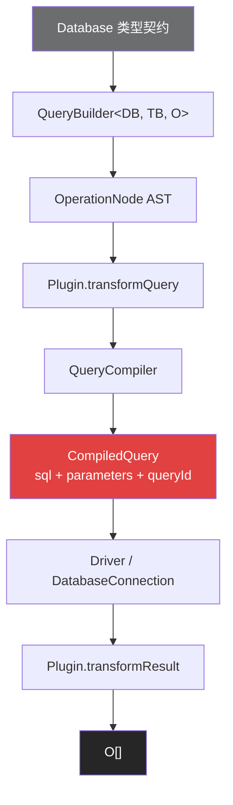
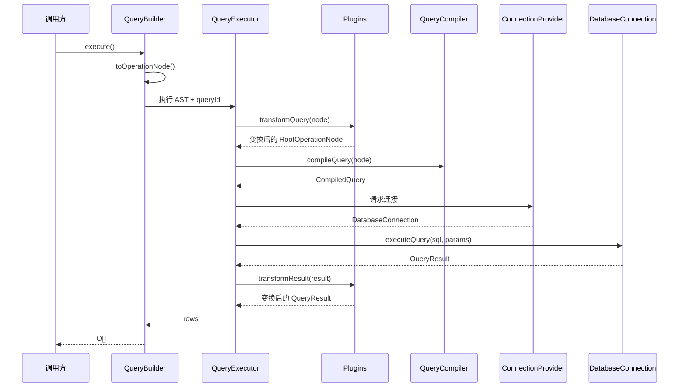

写 TypeScript 后端时，经常会遇到一个选择：不想让 ORM 接管实体、关系和生命周期，也不想靠字符串拼 SQL，还有没有中间层？

Kysely 给出的答案是一个类型安全的 SQL Query Builder。它保留 SQL 的表、列、JOIN、CTE、窗口函数等概念，同时用 TypeScript 描述当前查询能看到什么，以及执行后会返回什么。

从源码看，Kysely 可以拆成两套彼此配合、但互不替代的系统：

1. **编译期类型系统**：追踪表、别名、列、可空性和结果类型。
2. **运行时查询管线**：把链式调用构造成不可变 AST，经插件变换和方言编译后交给驱动执行。

这个区分很重要。类型只存在于编译期，AST、SQL、参数和数据库结果则存在于运行时。Kysely 的设计价值，正是让两条链尽可能对应，同时明确保留逃生口。

> 本文以 **Kysely 0.29.3** 的公开源码为基准。这一版本的核心方言包括 PostgreSQL、MySQL、MSSQL、SQLite 和 PGlite；包本身为 ESM-only。

## 先说边界：类型安全到底安全在哪里

“类型安全 SQL”容易让人误以为编译通过就等于查询正确。更准确的说法是：

| Kysely 能在编译期帮助检查 | Kysely 不会替你证明 |
|---|---|
| 当前上下文可见的表和列 | `Database` 类型与真实数据库是否一致 |
| 多数操作符两侧的值类型 | `GROUP BY`、约束和业务语义是否正确 |
| INSERT / UPDATE 字段是否可写、是否必填 | 驱动返回的运行时 JS 类型是否符合声明 |
| JOIN 后新增表的可空性 | `sql<T>` 中的 `T` 是否写对 |
| SELECT 字段、别名和结果对象形状 | `sql.raw`、动态标识符和第三方插件是否安全 |

所以，Kysely 不是 SQL 验证器，也不是运行时数据校验器。它建立的是一份由开发者维护的数据库类型契约，并让查询 API 尽量遵守这份契约。

## 一条查询的完整心智模型

先定义本文后面都会复用的 schema：

```ts
import type {
  ColumnType,
  Generated,
  Insertable,
  Selectable,
  Updateable,
} from 'kysely';

type CreatedAt = ColumnType<
  Date,                      // SELECT 时驱动返回的类型
  Date | string | undefined, // INSERT 时接受的类型
  never                      // 不允许 UPDATE
>;

interface UserTable {
  id: Generated<number>;
  name: string;
  email: string;
  active: boolean;
  created_at: CreatedAt;
}

interface OrderTable {
  id: Generated<number>;
  user_id: number;
  amount: number;
  status: 'pending' | 'paid' | 'refunded';
  created_at: CreatedAt;
}

export interface Database {
  users: UserTable;
  orders: OrderTable;
}

export type User = Selectable<UserTable>;
export type NewUser = Insertable<UserTable>;
export type UserUpdate = Updateable<UserTable>;
```

现在构造一条聚合查询：

```ts
const query = db
  .selectFrom('users as u')
  .innerJoin('orders as o', 'o.user_id', 'u.id')
  .select((eb) => [
    'u.id',
    'u.name',
    eb.fn.sum<number>('o.amount').as('total'),
  ])
  .where('o.status', '=', 'paid')
  .where('o.created_at', '>=', new Date('2026-01-01'))
  .groupBy(['u.id', 'u.name'])
  .having((eb) => eb.fn.sum<number>('o.amount'), '>', 1000)
  .orderBy('total', 'desc')
  .limit(20);

const rows = await query.execute();
// { id: number; name: string; total: number }[]
```

这段代码看起来接近 SQL，是因为方法名和参数都直接对应 SQL 概念。调用顺序也可以与 SQL 的阅读顺序一致。

不过，Kysely 并不是把链式调用逐段拼成字符串。它会先保存查询结构，最后再由编译器按 SQL 语法规定的顺序输出各个子句。

如果只想看编译结果，可以不执行：

```ts
const compiled = query.compile();

compiled.sql;        // 方言对应的 SQL
compiled.parameters; // ['paid', Date, 1000, 20]
compiled.query;      // RootOperationNode
compiled.queryId;    // 供插件关联查询变换与结果变换
```

这已经勾勒出整条链：



下面逐层拆开。

## Schema：一份编译期契约

Kysely 不要求运行时 schema DSL。传给 `Kysely<Database>` 的泛型就是查询类型系统的起点：`Database` 的 key 是表名，value 是列定义。

### `ColumnType` 的三个视角

`ColumnType<Select, Insert, Update>` 允许同一列在三种操作中拥有不同类型。例如，数据库驱动可能把时间戳读成 `Date`，但写入时同时接受 `Date` 和 ISO 字符串；某些生成列又不允许更新。

源码中的 `Generated<S>` 等价于：

```ts
type Generated<S> = ColumnType<S, S | undefined, S>;
```

它表示：

- SELECT 时得到 `S`；
- INSERT 时字段可省略，也可以显式提供 `S`；
- UPDATE 时仍可写 `S`，而 `Updateable` 会把所有可更新字段变成可选字段。

如果一列必须完全由数据库生成，可用 `GeneratedAlways<S>`，它的 Insert 和 Update 类型都是 `never`。

`Selectable<T>`、`Insertable<T>` 和 `Updateable<T>` 则把表定义投影成三个常用对象类型。它们只是 TypeScript 类型运算，不会生成 DDL，也不会改变运行时数据。

### 类型必须匹配驱动，而不只是 SQL 类型

Kysely 不负责把数据库值转换成你声明的 TypeScript 类型。以 PostgreSQL 为例，具体驱动可能把 `bigint` 或 `numeric` 返回为字符串。

遇到这种情况，应该调整驱动解析器，或者让 schema 反映实际返回的类型。

同样，聚合函数的返回类型并不总能从列类型唯一推出。`sum` 的默认输出是 `number | string | bigint`，示例中的 `sum<number>` 是开发者基于数据库和驱动行为做出的显式声明，不是 Kysely 对数据库的运行时保证。

### 手写还是生成

小项目可以手写 `Database`；生产项目也常用第三方工具从数据库反向生成，例如 `kysely-codegen`、`prisma-kysely` 或 `kanel-kysely`。

无论哪种方式，都要记住：数据库 schema 才是运行时事实，TypeScript 定义只是它的编译期投影。类型生成能降低漂移概率，但不能替代迁移审查和集成测试。

## 类型系统：`DB`、`TB`、`O` 三条状态

`SelectQueryBuilder<DB, TB, O>` 是理解查询类型的关键。可以把三个泛型粗略读成：

- `DB`：当前查询所知道的表到行类型的映射，包含别名和 JOIN 引入的可空性变化；
- `TB`：当前表达式允许引用的表名集合；
- `O`：到目前为止累计出的 SELECT 结果类型。

它们在链式调用中以不同方式演化。

### `selectFrom`：建立可见表集合

0.29.3 中的入口签名是：

```ts
selectFrom<TE extends TableExpressionOrList<DB, never>>(
  from: TE,
): SelectFrom<DB, never, TE>
```

`TableExpression` 不只可以是表名，还可以是带别名的表、子查询、动态表或表达式。`src/parser/table-parser.ts` 中的 `From` 和 `FromTables` 会从 `TE` 中提取新的表映射和可见表集合。

### 别名：类型层和运行时各解析一次

```ts
db.selectFrom('users as u')
```

在类型层，模板字面量类型把字符串拆成原表 `users` 和别名 `u`，于是后续可以引用 `u.id`，不能再把 `users.id` 当作当前表引用。

运行时的 `parseAliasedTable` 也会解析同一字符串，构造 `AliasNode(TableNode, IdentifierNode)`。两套实现目的不同：一套服务 TypeScript，一套服务 SQL 编译。

这也意味着别名语法不是完整 SQL parser。源码按明确的 `' as '` 分隔符处理字符串；复杂表达式应该使用 builder 或 `sql` 模板，而不是期待普通字符串参数理解任意 SQL。

### JOIN：扩大上下文，并传播可空性

`innerJoin` 会把新表加入 `DB` 和 `TB`。`leftJoin` 还会通过 `Nullable<R>` 把右表行类型的每个字段变为 `T | null`：

```ts
const row = await db
  .selectFrom('users as u')
  .leftJoin('orders as o', 'o.user_id', 'u.id')
  .select(['u.id', 'o.id as order_id'])
  .executeTakeFirst();

// row: { id: number; order_id: number | null } | undefined
```

严格来说，JOIN 改写的是查询上下文中对应表的列类型。已经累计在 `O` 中的字段不会被回头重写。RIGHT JOIN 和 FULL JOIN 也有对应的可空性传播规则。

四种 JOIN 对查询上下文的影响可以概括为下表。这里的“左表”指 `selectFrom` 已经引入的表，“右表”指本次 JOIN 引入的表。

| JOIN 类型 | 左表列类型 | 右表列类型 | 典型使用场景 |
|---|---|---|---|
| `innerJoin` | `T` | `T` | 强关联，两侧都必须存在 |
| `leftJoin` | `T` | `T \| null` | 保留左表，右表可以缺失 |
| `rightJoin` | `T \| null` | `T` | 保留右表，通常也可改写为 `leftJoin` |
| `fullJoin` | `T \| null` | `T \| null` | 合并两侧，两边都可以缺失 |

### `select`：把表达式合并进输出类型

选择普通列时，Kysely 从当前 `DB` / `TB` 中提取列类型；选择带别名的表达式时，别名成为输出对象的 key：

```ts
const result = await db
  .selectFrom('users as u')
  .select([
    'u.id',
    'u.email as login',
  ])
  .executeTakeFirstOrThrow();

// { id: number; login: string }
```

多次调用 `select` 会继续合并 `O`。`selectAll('u')` 会展开指定表；不带参数的 `selectAll()` 会展开当前所有表。

多表查询里应谨慎使用无参数的 `selectAll()`：两张表若有同名列，SQL 结果对象会发生键名碰撞，类型系统也无法替你恢复被覆盖的值。显式选择并起别名通常更稳妥。

### Expression Builder：共享当前查询上下文

回调参数 `eb` 是上下文感知的 Expression Builder。它的列引用同样受当前 `DB` / `TB` 限制：

```ts
.select((eb) => [
  'u.id',
  eb.fn.coalesce('u.name', eb.val('anonymous')).as('display_name'),
  eb
    .case()
    .when('u.active', '=', true)
    .then('active')
    .else('inactive')
    .end()
    .as('state'),
])
```

`eb.fn` 提供函数和聚合函数，`eb.case()` 构造 CASE，`eb(...)` 构造普通表达式。它们最终都实现 `OperationNodeSource`，因此可以嵌入查询 AST。

### 动态查询：`$if`、`$call` 和 `db.dynamic`

动态查询最容易丢失类型信息。`where` 不改变输出类型 `O`，所以重新赋值通常没有问题。

`select` 和 JOIN 会改变 builder 的泛型状态。如果仍用旧变量类型承接，新增的类型信息就可能丢失。

`$if` 用来保留条件分支引入的结果字段：

```ts
const row = await db
  .selectFrom('users')
  .select('id')
  .$if(includeEmail, (qb) => qb.select('email'))
  .executeTakeFirstOrThrow();

// { id: number; email?: string }
```

条件只在运行时可知，所以回调新增的输出字段会成为可选字段。`$call(fn)` 更简单：它把当前 builder 传给函数并原样返回函数结果，适合抽取可复用的查询变换。

当表名或列名直到运行时才知道，可以使用 `db.dynamic.ref` / `db.dynamic.table`，并通过泛型联合保留“可能是哪些列”的信息。

动态标识符必须先做白名单校验。它们不像普通值那样天然适合参数化。

### 类型系统不会验证 SQL 的全部语义

一个重要反例是 `groupBy`。源码签名返回的仍是 `SelectQueryBuilder<DB, TB, O>`，Kysely 不会检查每个非聚合选择列是否都出现在 `GROUP BY` 中。

不同数据库对此还有不同规则，这类语义最终由数据库判断。

类似地，窗口函数、数据库扩展、函数返回类型和方言特有行为都可能需要显式类型或运行时测试。Kysely 的类型精度很高，但不是 SQL 定理证明器。

到这里，编译期的变化可以压缩成一句话：`selectFrom` 建立可见范围，JOIN 改写查询上下文，`select` 累计输出类型。接下来，运行时会把同一组调用保存为 AST。

## 运行时：不可变的 OperationNode AST

链式调用在运行时不会立即生成最终 SQL。每个 builder 内部都持有一个 `SelectQueryNode`、`InsertQueryNode`、`UpdateQueryNode` 等根节点，方法调用通过 `cloneWith...` 工厂创建新节点。

例如：

```ts
db.selectFrom('users').where('id', '=', 1).selectAll()
```

对应的结构可以简化为：

```ts
{
  kind: 'SelectQueryNode',
  from: {
    kind: 'FromNode',
    froms: [{ kind: 'TableNode', table: { /* users */ } }],
  },
  where: {
    kind: 'WhereNode',
    where: {
      kind: 'BinaryOperationNode',
      leftOperand: { kind: 'ReferenceNode', /* id */ },
      operator: { kind: 'OperatorNode', operator: '=' },
      rightOperand: { kind: 'ValueNode', value: 1 },
    },
  },
  selections: [{ kind: 'SelectionNode', /* SelectAllNode */ }],
}
```

这些节点是冻结的普通对象。`SelectQueryNode.cloneWithSelections`、`QueryNode.cloneWithWhere` 等函数会复制根节点并复用未变化的子树，而不是原地修改旧 builder。

### 不可变性让查询可以安全分支

```ts
const activeUsers = db
  .selectFrom('users')
  .where('active', '=', true);

const emails = await activeUsers
  .select('email')
  .execute();

const withOrders = await activeUsers
  .innerJoin('orders', 'orders.user_id', 'users.id')
  .select(['users.id', 'orders.id as order_id'])
  .execute();
```

两个分支共享起点，但后续调用不会互相污染。这对组合筛选器、报表查询和可复用 helper 很重要。

## 插件：在编译前改 AST，在执行后改结果

`KyselyPlugin` 只有两个核心入口：

```ts
// 为突出插件协议，省略了 AbortSignal 等辅助字段。
interface KyselyPlugin {
  transformQuery(args: {
    node: RootOperationNode;
    queryId: QueryId;
  }): RootOperationNode;

  transformResult(args: {
    result: QueryResult<UnknownRow>;
    queryId: QueryId;
  }): Promise<QueryResult<UnknownRow>>;
}
```

执行器会按注册顺序调用 `transformQuery`，并要求插件返回相同 kind 的根节点；查询完成后，再调用 `transformResult`。

内置插件能说明这套机制的用途：

- `CamelCasePlugin` 把 TypeScript 侧的 camelCase 标识符转换为数据库侧的 snake_case，并把结果键转回 camelCase；
- `ParseJSONResultsPlugin` 为不会自动解析 JSON 的方言或驱动递归解析结果；
- `DeduplicateJoinsPlugin` 删除结构相同的重复 JOIN；
- `HandleEmptyInListsPlugin` 和 `SafeNullComparisonPlugin` 处理特定表达式边界。

插件能够实现审计标记、租户条件等横切逻辑，但软删除或行级权限不是“给所有 SELECT 随手加一个 WHERE”那么简单。子查询、JOIN、UPDATE、DELETE 和别名都需要一致处理。

权限隔离仍应优先依赖数据库约束或行级安全策略，插件更适合做可测试的查询变换。

## 编译：Visitor 把 AST 变成 SQL

`DefaultQueryCompiler` 继承 `OperationNodeVisitor`。它遍历 AST，并按 SQL 语法规定的顺序访问 selection、FROM、JOIN、WHERE、GROUP BY、HAVING 等节点。

普通值表达式通常会进入参数数组，而不是直接拼到 SQL 中。以 PostgreSQL 为例：

```ts
const compiled = db
  .selectFrom('users')
  .select('id')
  .where('email', '=', input)
  .compile();

// compiled.sql:
// select "id" from "users" where "email" = $1
// compiled.parameters:
// [input]
```

`CompiledQuery` 在 0.29.3 中包含四个字段：

```ts
interface CompiledQuery<O = unknown> {
  readonly query: RootOperationNode;
  readonly queryId: QueryId;
  readonly sql: string;
  readonly parameters: ReadonlyArray<unknown>;
}
```

方言编译器只覆盖差异部分。例如 PostgreSQL 使用 `$1` 形式的参数占位符和双引号标识符；MySQL 使用 `?` 和反引号；MSSQL 使用 `@1` 一类占位符，并定制 OFFSET、MERGE 等语法。

### 提前编译不是无条件的性能技巧

`db.executeQuery(compiled)` 确实允许把构建、编译和执行拆开，也能把 Kysely 当作纯 SQL 编译器使用。

但要注意，`CompiledQuery.parameters` 已经包含本次构建时的参数，插件的 `transformQuery` 也已在 `compile()` 期间执行。

因此，缓存 compiled query 只适合 SQL 和参数都可复用的场景。它首先是架构边界和互操作能力，不应在没有基准的情况下被当作通用优化。

## Dialect：把核心与数据库驱动隔开

`Dialect` 接口由四个工厂方法组成：

```ts
interface Dialect {
  createDriver(): Driver;
  createQueryCompiler(): QueryCompiler;
  createAdapter(): DialectAdapter;
  createIntrospector(db: Kysely<any>): DatabaseIntrospector;
}
```

- `Driver` 和 `DatabaseConnection` 负责连接、事务、执行与流式结果；
- `QueryCompiler` 负责把 AST 编译成目标 SQL；
- `DialectAdapter` 暴露方言能力和迁移锁等差异；
- `DatabaseIntrospector` 读取表、列、schema 和元数据。

0.29.3 源码内置 PostgreSQL、MySQL、MSSQL、SQLite 和 PGlite 方言。Cloudflare D1、PlanetScale、Neon、libSQL 等集成来自组织或社区包，应分别检查它们的维护状态、驱动语义和版本兼容性。

这也是 Kysely 能覆盖 Node.js、Deno、Bun、Cloudflare Workers 和浏览器场景的基础：核心查询模型不绑定 Node 原生模块。

但实际能否在某个运行环境中工作，取决于所选方言和底层驱动。不能只因为核心库是 TypeScript，就假设任意数据库连接都能在 Edge 环境运行。

## `sql` 模板：参数安全与逃生口

Builder 不可能覆盖每个数据库扩展。Kysely 用 `sql` 模板把原生 SQL 作为一等表达式嵌回 AST：

```ts
import { sql } from 'kysely';

const result = await db
  .selectFrom('users')
  .select([
    'id',
    sql<string>`lower(email)`.as('normalized_email'),
  ])
  .where(sql<string>`lower(email)`, '=', input.toLowerCase())
  .execute();
```

普通插值会被当成值参数：

```ts
sql`select * from users where email = ${input}`
```

但下面几类 API 会主动离开普通参数化路径：

- `sql.ref(name)`、`sql.table(name)`、`sql.id(...)`：动态标识符；
- `sql.lit(value)`：把值作为字面量写入 SQL；
- `sql.raw(text)`：直接注入 SQL 文本。

这些 API 的输入都应来自静态常量或严格白名单，不能直接接收用户输入。`sql<T>` 中的 `T` 也只是开发者给编译器的承诺，Kysely 不会解析 SQL 并验证返回类型。

## 执行链：`execute()` 到结果对象

`SelectQueryBuilderImpl.execute` 的主路径很短，但背后职责分层清楚：

1. builder 调用 `toOperationNode()`；
2. QueryExecutor 依次执行插件的 `transformQuery`；
3. 方言 QueryCompiler 生成 `CompiledQuery`；
4. ConnectionProvider 获取数据库连接；
5. `DatabaseConnection.executeQuery` 把 SQL 和参数交给底层驱动；
6. 连接被释放，结果依次经过插件的 `transformResult`；
7. `execute()` 返回其中的 `rows`。

用序列图看更清晰：



这条路径没有实体 hydrate、identity map 或变更追踪。结果默认就是驱动返回的普通对象；只有插件或驱动本身会改变其运行时形态。

Kysely 同时支持回调式事务。下面以支持 `RETURNING` 的方言为例：

```ts
await db.transaction().execute(async (trx) => {
  const user = await trx
    .insertInto('users')
    .values({
      name: 'Ada',
      email: 'ada@example.com',
      active: true,
    })
    .returning('id')
    .executeTakeFirstOrThrow();

  await trx
    .insertInto('orders')
    .values({
      user_id: user.id,
      amount: 100,
      status: 'pending',
    })
    .execute();
});
```

回调成功时提交，抛错时回滚。0.29.3 还提供 `startTransaction()` 控制式事务以及 savepoint API，但手动控制意味着调用方也必须负责所有提交、回滚和异常路径。

## Migration：有执行器，没有 schema diff

Kysely 内置 `Migrator` 和 schema builder：

```ts
import { sql, type Kysely } from 'kysely';

export async function up(db: Kysely<any>): Promise<void> {
  await db.schema
    .createTable('users')
    .addColumn('id', 'serial', (col) => col.primaryKey())
    .addColumn('email', 'text', (col) => col.notNull().unique())
    .addColumn('created_at', 'timestamptz', (col) =>
      col.defaultTo(sql`now()`).notNull()
    )
    .execute();
}

export async function down(db: Kysely<any>): Promise<void> {
  await db.schema.dropTable('users').execute();
}
```

`FileMigrationProvider` 可以从目录加载迁移，`Migrator` 负责排序、迁移表、锁和事务。但它不会比较 `Database` interface 与数据库，也不会自动生成 schema diff。

还有一个容易忽略的 API 细节：`migrateToLatest()` 返回 `MigrationResultSet`，错误放在 `error` 字段中，而不是通过该方法直接抛出。启动脚本必须显式检查：

```ts
const { error } = await migrator.migrateToLatest();

if (error) {
  throw error;
}
```

## 工程上的真实代价

Kysely 很薄，但“薄”不等于没有成本。

### TypeScript 复杂度

大型 CTE、深层 helper 或大量条件选择会让类型实例化变重，甚至触发 `TS2589: Type instantiation is excessively deep`。

`$assertType<T>()` 会先检查结构是否相等，再丢弃中间复杂类型；`$castTo<T>()` 则是显式强制转换。两者承担的安全责任不同，不能混为一谈。

### 运行时性能

Kysely 的额外工作主要是构建 AST、插件变换、编译和结果后处理。它没有 ORM 实体层，但不能据此凭空给出“微秒级”或固定 Bundle 大小结论。

查询复杂度、插件、打包器、驱动和运行环境都会影响结果。

性能优化仍应从慢查询、索引、往返次数、连接池和结果规模开始。只有 profiling 指向查询构建或结果插件时，缓存、减少插件或拆分编译执行才有依据。

### ESM 与版本约束

当前 `package.json` 只导出 ESM，声明 Node.js `>=22`，并通过 `typesVersions` 要求较新的 TypeScript 类型入口。

升级旧项目时，应先验证模块系统、Node 版本、方言包和驱动版本，而不是只替换一个依赖版本号。

### 常见问题与处理方式

下面这些问题最容易在接入或升级时出现。表格只保留“问题”和“处理”两列，便于快速定位。

| 问题 | 处理 |
|---|---|
| 深层 helper、递归 CTE 或大量条件 select 触发 `TS2589` | 拆分复杂查询；在 helper 出口用 `$assertType<T>()` 收窄 |
| PostgreSQL 的 `bigint` / `numeric` 实际返回 `string`，类型却声明为 `number` | 配置驱动 type parser，或让 schema 反映实际返回类型；必要时自定义 `ColumnType` |
| LEFT / RIGHT / FULL JOIN 让字段类型多出 `null` | 在业务侧显式处理 `null`；如果两侧记录都必须存在，改用 `innerJoin` |
| Edge Runtime 报缺少 Node 内置模块 | 换用 Neon HTTP、PlanetScale、libSQL 等兼容 Edge 的方言或驱动 |
| `migrateToLatest()` 看似完成，但表没有创建 | 检查返回值中的 `error`，并在启动脚本中显式抛出 |
| camelCase 与 snake_case 混用，运行时提示列不存在 | 在同一个 `Kysely` 实例上统一注册 `CamelCasePlugin`，并让 codegen 遵循同一约定 |
| `sql.raw(userInput)` 带来 SQL 注入风险 | `sql.raw` / `sql.lit` 只接收静态常量或白名单值；普通值使用 `${}` 插值 |

## Kysely 与其他方案怎么选

| 方案 | 主要抽象 | 类型通常来自 | 许可证 | 更适合 |
|---|---|---|---|---|
| Kysely | SQL Query Builder | interface 或第三方 codegen | MIT | 熟悉 SQL、复杂查询多、希望控制 SQL 形状 |
| Knex | Query Builder | 手写类型或外部约束 | MIT | 既有 Knex 项目、类型精度不是首要目标 |
| Drizzle | schema DSL + 查询 API | TypeScript schema | Apache-2.0 | 希望 schema、查询和迁移工具更紧密 |
| Prisma | schema + Client + 关系 API | schema codegen | Apache-2.0 | CRUD 与关系读取为主、需要完整工具链 |

这不是“谁更高级”的排序，而是抽象边界不同。

选择 Kysely 的信号：

- 团队能直接评审 SQL 语义；
- 查询包含较多 CTE、聚合、窗口函数、复杂 JOIN 或动态筛选；
- 希望结果是普通对象，不需要实体生命周期；
- 愿意维护数据库迁移与 TypeScript schema 的一致性；
- 需要替换驱动或方言，同时尽量保留查询层。

不适合优先选择 Kysely 的信号：

- 团队主要按实体关系思考，希望声明式加载嵌套关系；
- 期待修改 schema 后自动生成并管理 migration；
- 需要官方 Studio、关系模型和完整 CRUD 工作流；
- 团队缺乏 SQL 评审能力，却希望工具隐藏数据库细节。

ORM 与 Kysely 也可以共存，但要明确事务归属、连接池、迁移真源和类型生成方向，避免两个数据层各自维护一份不一致的 schema。

### 落地检查清单

真正接入项目前，建议按三个方面逐项确认。

#### 运行环境与驱动

- [ ] 已选定并锁定方言与驱动版本（PostgreSQL / MySQL / MSSQL / SQLite / PGlite 等）。
- [ ] Node.js 版本满足 `>=22`，构建工具支持纯 ESM 输出。
- [ ] 面向 Edge / Serverless 时，已确认所选方言不依赖 Node 原生模块。

#### 类型与查询

- [ ] `Database` interface 与目标数据库的真实 schema 一致，无论它来自手写还是 codegen。
- [ ] 时间戳、`bigint`、`numeric`、JSON 等类型的驱动解析行为已经反映在 schema 中。
- [ ] 团队已统一是否使用 `CamelCasePlugin`、`ParseJSONResultsPlugin` 等内置插件。
- [ ] `sql.ref`、`sql.raw` 等动态标识符路径有白名单校验。
- [ ] 关键复杂查询有集成测试，覆盖 JOIN 可空性与聚合返回类型。

#### 迁移与事务

- [ ] 迁移工具（`Migrator` + `FileMigrationProvider` 或第三方）已经就位并纳入 CI。
- [ ] 启动脚本会显式检查 `migrateToLatest()` 返回值中的 `error` 字段。
- [ ] 团队已经约定事务边界（callback 或 `startTransaction()`）与 savepoint 使用规范。

## 总结

Kysely 的核心不是“用链式 API 代替 SQL”，而是把一条查询拆成三个可组合的表示：

| 阶段 | 表示 | 主要职责 |
|---|---|---|
| 编译期 | `SelectQueryBuilder<DB, TB, O>` | 限制可见表列，累计结果类型 |
| 运行时构建 | 不可变 `OperationNode` | 保存结构，支持复用和插件变换 |
| 执行边界 | `CompiledQuery` | 携带 SQL、参数、AST 和 queryId |

它刻意不做实体映射、关系元数据和 schema diff，把这些能力留给应用、数据库或其他工具。换来的不是“零抽象”，而是一层边界清晰、能从 TypeScript 一直追到最终 SQL 的抽象。

如果团队的心智模型是“SQL 由我负责，编译器帮我约束输入和结果”，Kysely 很合适。

真正需要记住的不是它有多少类型体操，而是这条边界：**类型系统提高反馈速度，AST 保持运行时可组合，数据库仍然是语义与数据的最终裁判。**

## 源码索引

- [Kysely 官方文档](https://kysely.dev/)
- [`src/query-creator.ts`](https://github.com/kysely-org/kysely/blob/master/src/query-creator.ts)：`selectFrom` 等查询入口
- [`src/query-builder/select-query-builder.ts`](https://github.com/kysely-org/kysely/blob/master/src/query-builder/select-query-builder.ts)：`DB / TB / O`、JOIN、`$if` 与执行
- [`src/util/column-type.ts`](https://github.com/kysely-org/kysely/blob/master/src/util/column-type.ts)：`ColumnType`、`Generated` 和三种对象投影
- [`src/parser/table-parser.ts`](https://github.com/kysely-org/kysely/blob/master/src/parser/table-parser.ts)：表名与别名的类型/运行时解析
- [`src/operation-node/`](https://github.com/kysely-org/kysely/tree/master/src/operation-node)：AST 节点与不可变 clone 工厂
- [`src/query-compiler/default-query-compiler.ts`](https://github.com/kysely-org/kysely/blob/master/src/query-compiler/default-query-compiler.ts)：visitor 编译主流程
- [`src/query-executor/query-executor-base.ts`](https://github.com/kysely-org/kysely/blob/master/src/query-executor/query-executor-base.ts)：插件、连接和执行链
- [`src/dialect/`](https://github.com/kysely-org/kysely/tree/master/src/dialect)：核心方言、驱动、adapter 和 introspector
- [`src/raw-builder/sql.ts`](https://github.com/kysely-org/kysely/blob/master/src/raw-builder/sql.ts)：`sql` 模板与安全边界
- [`src/migration/migrator.ts`](https://github.com/kysely-org/kysely/blob/master/src/migration/migrator.ts)：迁移排序、锁和结果模型
- [Kysely 类型生成文档](https://kysely.dev/docs/generating-types)
