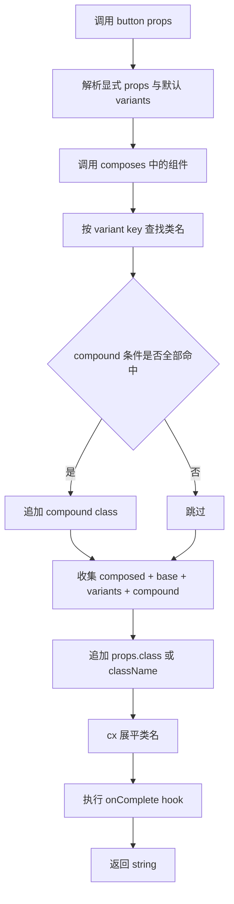

# cva@beta 深度解析

> 官网：<https://cva.style/>
> Beta 文档：<https://cva.style/beta/getting-started/installation/>
> 仓库：<https://github.com/joe-bell/cva>
> License：Apache-2.0
> 版本范围：本文示例已使用 `cva@1.0.0-beta.8` 验证；`beta` tag 仍可能指向后续预发布版本

---

## 心智模型：把 className 当成数据

一句话概括 cva：

> **cva 把“有限的组件选项到 className 字符串”建模为一个带类型的纯函数。**

传统写法经常把条件直接塞进模板字符串：

```tsx
<button
  className={`button ${size === "sm" ? "button-sm" : "button-md"} ${
    danger ? "button-danger" : ""
  }`}
/>
```

这段代码本身不会让 TypeScript 失效。如果 `size` 已声明为字面量联合类型，错误取值仍会被拦住。真正的问题通常是：

1. variant 的允许值、默认值和类名映射散落在不同位置。
2. 维度增多后，多层 `if` 或三元表达式很难快速扫描。
3. 跨维度规则容易和普通样式分支混在一起。

cva 把这些信息集中到一个 schema 中，再返回 `(props) => string`。它不生成 CSS、不注入 `<style>`，也不关心类名来自 Tailwind、CSS Modules、BEM 还是普通 CSS。

---

## 1. 为什么本文使用 `cva@beta`

安装：

```sh
pnpm add cva@beta
```

然后从短包名导入：

```ts
import { cva, cx, defineConfig, getSchema, type VariantProps } from "cva"
```

相较 0.x，1.0 beta 有几项会直接影响代码写法的变化：

| 变化 | 1.0 beta 写法 |
|---|---|
| 包名 | 从 `"cva"` 导入 |
| `cva` 参数 | 使用单个 options 对象，基础类放在 `base` |
| 禁用某个 variant | 声明显式选项，如 `unset: null` |
| 自定义类名合并 | `defineConfig({ hooks: { onComplete } })` |
| 组件组合 | `cva({ composes: ... })` |
| 运行时 schema | `getSchema(component)` |
| 内部 variant | 名称以 `_` 开头 |

最容易迁移错的是调用签名：

```diff
- const button = cva("button", { variants: { /* ... */ } })
+ const button = cva({
+   base: "button",
+   variants: { /* ... */ },
+ })
```

> [!WARNING]
> 从 `cva("button", { ... })` 迁移到单对象配置时，基础类必须移入 `base` 字段，否则会静默丢失。这是 0.x → 1.0 beta 最常见的迁移错误。

`beta` 是可移动的 dist-tag。可复现构建应让 lockfile 固定解析结果；库作者若需要严格复现，还可以直接固定具体 beta 版本。

---

## 2. 核心 API：从一个完整例子开始

```ts
import { cva } from "cva"

const button = cva({
  base: "inline-flex items-center rounded font-medium",
  variants: {
    intent: {
      unset: null,
      primary: "bg-blue-600 text-white hover:bg-blue-700",
      secondary: "bg-white text-gray-900 hover:bg-gray-100",
    },
    size: {
      sm: "h-8 px-3 text-sm",
      md: "h-10 px-4 text-base",
    },
    disabled: {
      true: "cursor-not-allowed opacity-50",
      false: null,
    },
  },
  compoundVariants: [
    {
      intent: ["primary", "secondary"],
      size: "md",
      class: "font-semibold",
    },
  ],
  defaultVariants: {
    intent: "primary",
    size: "md",
    disabled: false,
  },
})
```

调用结果是普通字符串：

```ts
button()
// => "inline-flex items-center rounded font-medium bg-blue-600 text-white
//     hover:bg-blue-700 h-10 px-4 text-base font-semibold"

button({ intent: "secondary", size: "sm", disabled: true })
// => "inline-flex items-center rounded font-medium bg-white text-gray-900
//     hover:bg-gray-100 h-8 px-3 text-sm cursor-not-allowed opacity-50"

button({ intent: "unset", size: "sm", class: "tracking-wide" })
// => "inline-flex items-center rounded font-medium h-8 px-3 text-sm tracking-wide"
```

options 对象中的主要字段：

| 字段 | 作用 |
|---|---|
| `base` | 无条件加入的类名 |
| `variants` | 每个 variant 维度的“取值到类名”映射 |
| `compoundVariants` | 多个条件同时命中时追加类名 |
| `defaultVariants` | 调用方未提供取值时使用的默认值 |
| `composes` | 合并一个或多个 cva 组件 |

调用时还可以传 `class` 或 `className`。两者都接受 clsx 的 `ClassValue`，但类型上不能在同一次调用中同时传入。

---

## 3. 执行模型

一次 `button({ intent: "secondary", size: "sm" })` 大致经历以下步骤：



不使用 `composes` 或自定义 hook 时，相应步骤为空。响应式行为仍由 `sm:`、`md:` 等 CSS 类负责，cva 本身不监听媒体查询或组件状态。

若 `V` 是 variant 维度数，`C` 是所有 compound 条件项的总数，核心查找与匹配可近似看作 O(V + C)，另加与类名输入规模相关的 clsx 展平成本。使用 `composes` 时，还要计算被组合组件各自的结果。

---

## 4. 类型系统：`VariantProps` 与内部 variants

`VariantProps` 从 cva 组件函数中提取公开的 variant props：

```ts
import { cva, type VariantProps } from "cva"

const badge = cva({
  variants: {
    tone: {
      neutral: "badge-neutral",
      positive: "badge-positive",
    },
    outlined: {
      true: "border",
      false: null,
    },
  },
})

type BadgeVariants = VariantProps<typeof badge>
// {
//   tone?: "neutral" | "positive" | undefined
//   outlined?: boolean | undefined
// }
```

对象键 `"true"` / `"false"` 会被映射为 boolean prop，因此调用时写 `outlined: true`，而不是字符串 `"true"`。

> [!TIP]
> schema 里用字符串键 `"true"` / `"false"` 声明，调用时却要传真正的布尔值 `outlined: true`。写成 `outlined: "true"` 会触发类型错误。

### 内部 variants

beta 约定以下划线开头的 variant 为内部 variant：

```ts
const chip = cva({
  variants: {
    tone: {
      neutral: "chip-neutral",
      accent: "chip-accent",
    },
    _density: {
      compact: "gap-1",
      comfortable: "gap-2",
    },
  },
  defaultVariants: {
    _density: "comfortable",
  },
})

type ChipProps = VariantProps<typeof chip>
// 只包含 tone，不暴露 _density

chip({ tone: "accent", _density: "compact" })
// cva 组件本身仍可在实现内部设置 _density
```

`VariantProps` 和 `getSchema` 都会省略 `_density`，但 cva 组件函数仍接受它。这适合表达由组件实现控制、不希望调用方直接修改的视觉维度。

如果某个 variant 必须传入，cva 不提供额外 API，可使用 TypeScript 工具类型：

```ts
type Variants = VariantProps<typeof badge>

type BadgeProps =
  Omit<Variants, "tone"> &
  Required<Pick<Variants, "tone">>
```

---

## 5. `compoundVariants` 的匹配语义

`compoundVariants` 用于表达跨维度规则：

```ts
compoundVariants: [
  {
    intent: "primary",
    size: "md",
    class: "shadow-md",
  },
]
```

只有 `intent === "primary"` 且 `size === "md"` 时才会追加 `shadow-md`。未写入条件对象的维度视为任意值。

单个条件也可以匹配一组值：

```ts
compoundVariants: [
  {
    intent: ["primary", "secondary"],
    size: "md",
    className: "uppercase",
  },
]
```

多个 compound 同时命中时，类名按配置顺序收集。对于 Tailwind，class attribute 中的文本顺序通常不决定最终 CSS，结果取决于生成样式表的规则顺序和特异性。需要让后输入的 utility 稳定覆盖前者时，应使用下一节的 `tailwind-merge` 集成。

---

## 6. Goodbye `null`：如何显式禁用 variant

0.x 曾允许调用方通过 `variant: null` 跳过某个维度。beta 已从 variant prop 类型中移除 `null`，不要继续把它当作 escape hatch：

```ts
button({ intent: null })
// TypeScript error
```

推荐在 schema 中声明一个语义明确的选项，并把该选项的类名设为 `null`：

```ts
const button = cva({
  base: "button",
  variants: {
    intent: {
      unset: null,
      primary: "button-primary",
      secondary: "button-secondary",
    },
  },
})

button({ intent: "unset" })
// => "button"
```

> [!IMPORTANT]
> 这里的 `null` 是 **schema 中某个选项对应的 ClassValue**，不是调用时的 variant prop。两者不要混淆。

`undefined` 仍表示“没有显式提供”，因此存在 `defaultVariants` 时会回退到默认值。

---

## 7. `cx`、`defineConfig` 与 Tailwind 冲突合并

默认导出的 `cx` 是 clsx 的包装：负责条件拼接和嵌套展平，不理解 Tailwind 冲突。

```ts
import { cx } from "cva"

cx("px-2", "px-4")
// => "px-2 px-4"
```

> [!NOTE]
> `cx("px-2", "px-4")` 会保留两个类，而不是让后者覆盖前者。若需要 utility 冲突合并，要通过下面的 `defineConfig` 接入 `tailwind-merge`。

beta 的 `defineConfig` 可以为 `cva` 和 `cx` 统一增加完成 hook：

```ts
// cva.config.ts
import { defineConfig } from "cva"
import { twMerge } from "tailwind-merge"

export const { cva, cx } = defineConfig({
  hooks: {
    onComplete: (className) => twMerge(className),
  },
})
```

之后从这个模块导入配置后的函数：

```ts
import { cva, cx } from "./cva.config"

const panel = cva({
  base: "p-2",
  variants: {
    spacious: {
      true: "p-6",
      false: null,
    },
  },
})

panel({ spacious: true }) // => "p-6"
cx("px-2", "px-4")      // => "px-4"
```

`onComplete` 会处理每次 `cva` 和 `cx` 的最终字符串，不必再要求每个调用点手工包一层 `twMerge`。代价是所有调用都会执行合并逻辑；是否启用应由实际覆盖需求决定。

Tailwind CSS IntelliSense 还可以通过编辑器配置识别函数参数中的类名：

```json
{
  "tailwindCSS.classFunctions": ["cva", "cx"]
}
```

---

## 8. `composes`：组合与扩展 cva 组件

beta 使用 `composes` 合并 cva 组件：

```ts
import { cva, type VariantProps } from "cva"

const surface = cva({
  base: "border",
  variants: {
    elevation: {
      flat: null,
      raised: "shadow-md",
    },
  },
  defaultVariants: {
    elevation: "flat",
  },
})

const card = cva({
  composes: surface,
  base: "rounded-lg",
  variants: {
    padding: {
      sm: "p-3",
      lg: "p-6",
    },
  },
  defaultVariants: {
    padding: "sm",
  },
})

type CardProps = VariantProps<typeof card>
// elevation 与 padding 都会被推导出来

card({ elevation: "raised" })
// => "border shadow-md rounded-lg p-3"
```

也可以组合多个组件：

```ts
const card = cva({ composes: [surface, layout] })
```

需要注意三条规则：

1. 同名 variant 的取值会浅合并，命中的各组件类名都会保留。
2. 同名 `defaultVariants` 按后者优先；当前组件自己的默认值优先级最高。
3. 多组件数组应直接写成 inline tuple，或为预先声明的数组添加 `as const`，避免类型被拓宽。

旧的 `compose(...)` 函数在 beta 中仍可用于迁移，但已经 deprecated；新代码应使用 `composes`。

---

## 9. `getSchema`：读取运行时 variant 元数据

`VariantProps` 解决编译期类型问题，`getSchema` 则返回运行时可读取的普通对象：

```ts
import { cva, getSchema } from "cva"

const badge = cva({
  variants: {
    tone: {
      neutral: "badge-neutral",
      positive: "badge-positive",
    },
    outlined: {
      true: "border",
      false: null,
    },
    _density: {
      compact: "gap-1",
      comfortable: "gap-2",
    },
  },
  defaultVariants: {
    tone: "neutral",
    outlined: false,
  },
})

getSchema(badge)
// => {
//   tone: {
//     values: ["neutral", "positive"],
//     defaultValue: "neutral",
//   },
//   outlined: {
//     values: [true, false],
//     defaultValue: false,
//   },
// }
```

返回值具有完整类型，且会省略：

- 以下划线开头的内部 variants；
- 没有任何可选值的空 variant。

这使 Storybook controls、属性面板或组件文档可以直接读取同一份 schema，而不必维护第二份 variant 列表。

---

## 10. 与相邻工具的边界

| 特性 | **cva@beta** | **tailwind-variants** | **clsx** | **Stitches** |
|---|---|---|---|---|
| variants schema | ✅ | ✅ | ❌ | ✅ |
| compound variants | ✅ | ✅ | ❌ | ✅ |
| 默认 variants | ✅ | ✅ | ❌ | ✅ |
| 组件组合 | ✅ (`composes`) | ✅ (`extend`) | ❌ | 通过组件组合 |
| slots API | ❌ | ✅ | ❌ | ❌ |
| 运行时 schema | ✅ (`getSchema`) | ❌ | ❌ | ❌ |
| Tailwind 冲突合并 | 通过 `defineConfig` 接入 | 内置 | ❌ | N/A |
| 生成 CSS | ❌ | ❌ | ❌ | ✅ |
| 类型推导 | ✅ | ✅ | ❌ | ✅ |

简单选型：

- 只需要条件拼接类名：`clsx`。
- 需要有限 variants、类型推导和组合：`cva`。
- 需要多 slot 共用一套 variant：评估 `tailwind-variants`。
- 需要工具同时生成 CSS：选择符合技术栈的 CSS-in-JS 或构建期 CSS 方案。

---

## 11. License

`cva` 使用 Apache-2.0。它是一种宽松许可证，并包含贡献者专利授权与特定专利诉讼下的终止条款。

这与 MIT 文本没有单独专利授权条款有所不同，但不能仅凭这一点判断某个许可证适合所有发布场景。实际分发与合规要求仍应按组织流程确认。

---

## 12. 性能边界

cva 的主要运行时工作是：

1. 解析显式 props 与默认值。
2. 按 variant key 查表。
3. 遍历 compound 条件。
4. 计算被组合组件。
5. 通过 clsx 展平类名。
6. 如果配置了 `onComplete`，执行最终 hook。

这类开销通常很小，但不应脱离运行环境给出固定微秒数字。`tailwind-merge` 需要解析 utility token，比单纯 clsx 做更多工作；`composes` 也会调用各组成组件。出现真实热点时，应在目标构建和设备上测量完整渲染路径。

cva schema 应定义在模块级，避免在每次渲染时重复创建组件函数。重新生成内容相同的字符串本身不会因为“引用不同”强制更新 DOM；JavaScript 字符串按值比较。

---

## 13. 何时不该用 cva

1. **只有一次性的简单分支**：没有可复用的 variant 契约时，三元表达式配合 `cx` 更直接。
2. **值是连续的**：进度、坐标、角度或用户选色更适合 inline style 或 CSS variables。
3. **核心需求是生成 CSS**：cva 只组合已有类名，不创建 CSS 规则。
4. **多 slot 是主要抽象**：若多个子元素必须共享同一套 variant，专门的 slots API 可能更合适。
5. **条件本质上是应用状态**：请求生命周期、权限或工作流应先由状态模型表达，再把最终视觉枚举交给 cva。

判断标准不是“有几个 variant”，而是是否存在一份值得集中维护、可复用且有限的视觉契约。

---

## 结语

`cva@beta` 不只是把旧包名缩短。单对象配置让 schema 更完整，`defineConfig` 提供统一扩展点，`composes` 让组件契约可以组合，`getSchema` 把类型信息对应的运行时元数据也开放出来，而内部 variants 则明确区分了公开 API 与实现细节。

它仍然保持最核心的边界：只负责从 props 生成 className，不生成 CSS。理解这条边界，再根据是否存在稳定的有限 variant 契约来选用 cva，通常就不会过度设计。

---

**参考链接**

- Beta 安装：<https://cva.style/beta/getting-started/installation/>
- Beta 新特性：<https://cva.style/beta/getting-started/whats-new/>
- Beta variants：<https://cva.style/beta/getting-started/variants/>
- Beta 组件组合：<https://cva.style/beta/getting-started/composing-components/>
- Beta TypeScript：<https://cva.style/beta/getting-started/typescript/>
- Beta API Reference：<https://cva.style/beta/api-reference/>
- GitHub：<https://github.com/joe-bell/cva>
- clsx：<https://github.com/lukeed/clsx>
- tailwind-merge：<https://github.com/dcastil/tailwind-merge>
- Apache-2.0：<https://www.apache.org/licenses/LICENSE-2.0>
