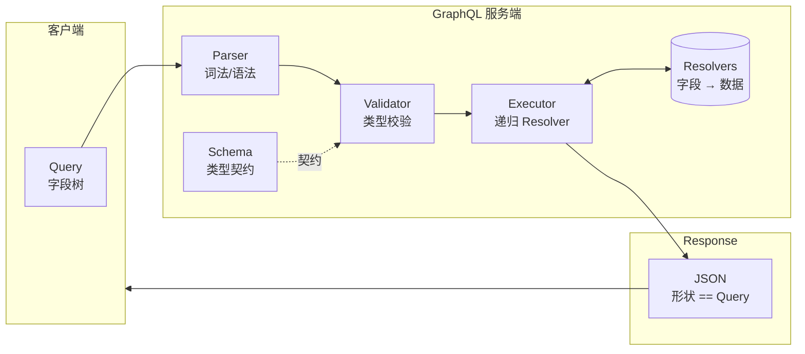
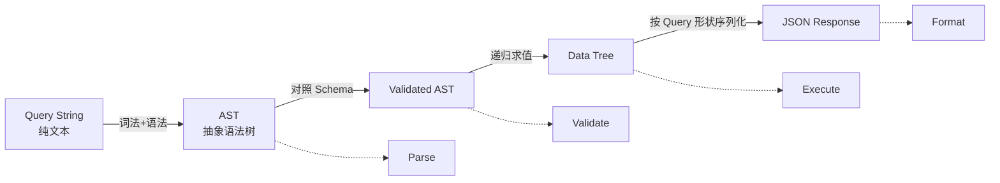

# 深入理解 GraphQL：一条查询是怎么被"执行"出来的

大多数后端开发者对 GraphQL 的第一印象是"一个更灵活的 REST"——客户端能自选字段、避免冗余。但这只是表象。真正让 GraphQL 与众不同的，是它把「**响应结构**」的定义权从服务端交回给了客户端，而服务端只做一件事：**按客户端给的字段树，递归调用 Resolver**。

一旦理解这一层，你会发现 GraphQL 里所有"看起来独立"的特性——片段（Fragment）、指令（Directive）、订阅（Subscription）、DataLoader、Federation——其实都是这个核心机制的自然延伸。

> 本文示例基于 `graphql-js` 16.x 与 Node.js 20+。核心概念对任何语言的实现（graphql-go / graphql-java / async-graphql 等）通用。

---

## 一、先建立心智模型：Schema 是契约，Query 是响应的形状

在 REST 里，URL 决定语义，服务端决定返回什么字段。在 GraphQL 里，规则彻底反过来了：

- **服务端只声明「能查什么」**——通过 Schema 定义类型、字段、关系。
- **客户端决定「实际要什么」**——通过 Query 挑选字段树。
- **响应的形状 = 查询的形状**。这是 GraphQL 最本质的不变式。



一句话概括：**GraphQL 引擎是一个"按 Query 形状驱动的 Resolver 调度器"**。它不关心你的数据来自 MySQL、Redis、微服务还是文件——只要你告诉它每个字段怎么取。

---

## 二、查询处理的四阶段流水线

任何一条 GraphQL 查询，在服务端都会走完这四步：



| 阶段 | 输入 | 输出 | 核心工作 |
|------|------|------|----------|
| **Parse** | Query 字符串 | AST | 词法分析（Lexer）+ 语法分析（Parser） |
| **Validate** | AST + Schema | 已校验 AST | 字段是否存在、参数类型是否匹配、片段循环检测 |
| **Execute** | 已校验 AST + Resolvers | 数据树 | 深度优先遍历字段，逐个调用 Resolver |
| **Format** | 数据树 | JSON | 按 Query 形状扁平化、错误合并 |

理解了这四步，任何 GraphQL 服务端框架的源码你都能"看进去"。

---

## 三、最小可运行示例：一个完整闭环

先动手跑一遍再讲原理，比反过来学得快得多。

```bash
mkdir gql-demo && cd gql-demo
npm init -y
npm install graphql
# 在 package.json 里加 "type": "module"
```


```javascript
// server.mjs —— GraphQL 查询处理的最小闭环
import { graphql, buildSchema } from 'graphql';

/**
 * 1) 定义 Schema
 *    Schema 是 GraphQL 的"契约"：客户端能看到什么、服务端能提供什么，
 *    都以它为唯一真源（Single Source of Truth）。
 */
const schema = buildSchema(`
  type User {
    id: ID!
    name: String!
    posts: [Post!]!
  }
  type Post {
    id: ID!
    title: String!
    author: User!
  }
  type Query {
    user(id: ID!): User
    posts: [Post!]!
  }
`);

/**
 * 2) 模拟数据源
 *    真实场景可能是 MySQL / Redis / 远端 RPC / 甚至多个上游聚合。
 *    GraphQL 引擎完全不关心数据从哪来。
 */
const db = {
  users: {
    '1': { id: '1', name: 'Alice' },
    '2': { id: '2', name: 'Bob' },
  },
  posts: [
    { id: 'p1', authorId: '1', title: 'GraphQL 入门' },
    { id: 'p2', authorId: '1', title: 'Resolver 详解' },
    { id: 'p3', authorId: '2', title: '类型系统设计' },
  ],
};

/**
 * 3) Resolver:告诉引擎"每个字段怎么取"
 *    嵌套字段常用函数(惰性求值)——只有客户端 query 到时才执行。
 */
const rootValue = {
  /**
   * 根字段:按 id 查用户
   * @param {{ id: string }} args - 查询参数
   * @returns {object|null} 用户对象;posts 字段是惰性函数
   */
  user: ({ id }) => {
    const u = db.users[id];
    if (!u) return null;
    return {
      ...u,
      posts: () => db.posts.filter(p => p.authorId === id),
    };
  },
  /**
   * 根字段:所有文章
   * @returns {Array<object>} 文章列表,每篇附带 author 惰性解析
   */
  posts: () => db.posts.map(p => ({
    ...p,
    author: () => db.users[p.authorId],
  })),
};

/**
 * 4) 客户端查询:只索要需要的字段(避免 over/under-fetching)
 */
const query = `
  query GetUserWithPosts {
    user(id: "1") {
      name
      posts { title }
    }
  }
`;

/**
 * 5) 执行:graphql() 内部完成 parse → validate → execute → format 全流程
 */
const result = await graphql({ schema, source: query, rootValue });
console.log(JSON.stringify(result, null, 2));
```

运行 `node server.mjs`：

```json
{
  "data": {
    "user": {
      "name": "Alice",
      "posts": [
        { "title": "GraphQL 入门" },
        { "title": "Resolver 详解" }
      ]
    }
  }
}
```

**关键观察**：响应里没有 `id`、没有 `author`——因为客户端没要。响应的形状与 Query 的形状**逐字段对应**。

---

## 四、Parse 阶段：字符串如何变成 AST

Parse 与你熟悉的 JS/TS 编译器前端一模一样——先词法，再语法。

**词法（Lexer）** 把字符流切成 Token：

```
"query { user(id: \"1\") { name } }"
      ↓
[QUERY] [BRACE_L] [NAME:user] [PAREN_L] [NAME:id] [COLON] [STRING:1] [PAREN_R] [BRACE_L] [NAME:name] [BRACE_R] [BRACE_R]
```

**语法（Parser）** 按 GraphQL 语法规则把 Token 流构造成 AST：

```javascript
/**
 * 观察 Parse 阶段的产出
 * 直接调用 graphql-js 底层的 parse,不涉及 Schema
 */
import { parse } from 'graphql';

const ast = parse(`
  query GetUser {
    user(id: "1") { name }
  }
`);

console.log(JSON.stringify(ast, null, 2));
```

节选输出（结构非常规整）：

```json
{
  "kind": "Document",
  "definitions": [{
    "kind": "OperationDefinition",
    "operation": "query",
    "name": { "kind": "Name", "value": "GetUser" },
    "selectionSet": {
      "kind": "SelectionSet",
      "selections": [{
        "kind": "Field",
        "name": { "value": "user" },
        "arguments": [{
          "kind": "Argument",
          "name": { "value": "id" },
          "value": { "kind": "StringValue", "value": "1" }
        }],
        "selectionSet": {
          "selections": [{ "kind": "Field", "name": { "value": "name" } }]
        }
      }]
    }
  }]
}
```

**要点**：Parse 只关心语法合法性，**完全不看 Schema**。你写 `user(id: "1") { xxxNotExist }` 也能 parse 成功——这个错误由下一阶段抓。

---

## 五、Validate 阶段：AST 与 Schema 的类型握手

Validate 用一组 **规则集（Validation Rules）** 遍历 AST，把每个字段/参数/片段与 Schema 对齐：

```javascript
/**
 * 观察 Validate 阶段
 * 传入错误的字段名,看引擎返回什么
 */
import { parse, validate, buildSchema } from 'graphql';

const schema = buildSchema(`
  type Query { user(id: ID!): User }
  type User { name: String! }
`);

const badAst = parse(`{ user(id: "1") { nam } }`); // nam 是拼写错误
const errors = validate(schema, badAst);
console.log(errors.map(e => e.message));
// [ 'Cannot query field "nam" on type "User". Did you mean "name"?' ]
```

内置规则涵盖：
- **字段存在性**：`Cannot query field "nam" on type "User"`
- **参数类型**：`Expected type ID!, found 123`
- **必填字段**：`Field "user" argument "id" of type "ID!" is required`
- **片段循环**：防止 `fragment A on X { ...B }` + `fragment B on X { ...A }` 无限递归
- **变量使用**：声明的 `$foo` 必须被用到，且类型匹配

**Validate 通过 = 后续 Execute 阶段可以放心假设 AST 与 Schema 一致**，不用再做类型检查。这是性能优化的关键：Execute 里全是"按名字取值+调 Resolver"，没有重复校验。

---

## 六、Execute 阶段：递归调度 Resolver

这是 GraphQL 的心脏。用 30 行代码可以完整还原它的核心：

```javascript
/**
 * 迷你 GraphQL 执行器:演示 Execute 阶段的核心递归
 * @param {object} selection - 已解析的字段选择(AST 简化版)
 * @param {object} resolvers - 字段名 → resolver 函数
 * @param {*}      parent    - 上一层字段返回的对象,作为下层 resolver 的 source
 * @returns {object} 按 selection 形状组装出的数据
 */
function execute(selection, resolvers, parent = null) {
  const result = {};
  for (const [fieldName, sub] of Object.entries(selection)) {
    // 优先用显式 resolver,否则从 parent 直接读同名属性(默认解析器)
    const resolver = resolvers[fieldName] ?? (() => parent?.[fieldName]);
    const value = resolver(sub.args ?? {}, parent);

    if (sub.children) {
      // 嵌套字段:递归下钻,数组会 map
      result[fieldName] = Array.isArray(value)
        ? value.map(item => execute(sub.children, {}, item))
        : execute(sub.children, {}, value);
    } else {
      result[fieldName] = value; // 叶子字段:直接返回
    }
  }
  return result;
}

/**
 * 模拟一条已经 parse+validate 完的 query:
 *   { user(id:"1") { name, posts { title } } }
 */
const selection = {
  user: {
    args: { id: '1' },
    children: {
      name:  {},
      posts: { children: { title: {} } },
    },
  },
};

const resolvers = {
  user: ({ id }) => ({
    name: 'Alice',
    posts: [{ title: 'GraphQL 入门' }, { title: 'Resolver 详解' }],
  }),
};

console.log(JSON.stringify(execute(selection, resolvers), null, 2));
```

真实的 `graphql-js` 执行器多做了这些事：

1. **Promise 自动 await**：Resolver 可返回 Promise，引擎自动拉平。
2. **并行执行**：同一层的字段默认**并行**调用 Resolver（除 mutation 外，mutation 强制串行以保证副作用顺序）。
3. **错误传播**：某个非空字段抛错时，向上冒泡到最近的可空字段，其他兄弟字段仍继续执行。
4. **上下文传递**：`(parent, args, context, info)` 四参数签名，`context` 通常放认证信息、DataLoader 实例。

---

## 七、Resolver 的完整签名：`(parent, args, context, info)`

生产项目一定要用完整签名的 Resolver（`buildSchema` 的 `rootValue` 只是简化写法）：

```javascript
/**
 * 完整签名的 Resolver
 * @param {*} parent  - 父字段返回的对象(顶层字段是 rootValue)
 * @param {object} args - 客户端传入的参数,已按 Schema 类型转换
 * @param {object} context - 每次请求的上下文(认证/DB 连接/DataLoader)
 * @param {object} info - 当前字段的 AST 与执行元信息(高级用法)
 */
const resolvers = {
  Query: {
    user: async (_parent, { id }, ctx, _info) => {
      if (!ctx.user) throw new Error('Unauthorized');
      return ctx.db.user.findUnique({ where: { id } });
    },
  },
  User: {
    // 嵌套 Resolver:parent 就是 User 对象
    posts: async (user, _args, ctx) => {
      return ctx.loaders.postsByUser.load(user.id); // DataLoader 批量取
    },
  },
};
```

**context 是唯一推荐的"跨 Resolver 共享状态"通道**——不要用模块级全局变量，那会在多请求并发时污染。

---

## 八、N+1 问题与 DataLoader

这是 GraphQL 生产环境**必踩**的坑。看这条查询：

```graphql
{
  posts {         # 1 次 SQL:SELECT * FROM posts
    title
    author {      # N 次 SQL:每篇 post 一次 SELECT * FROM users WHERE id=?
      name
    }
  }
}
```

100 篇文章 = **1 + 100 = 101 次数据库查询**。这就是 N+1 问题的由来——GraphQL 的字段递归天然会展开成大量单点查询。

解决方案是 [DataLoader](https://github.com/graphql/dataloader)：**收集同一 tick 内所有 `.load(id)` 调用，合并成一次批量查询**。

```javascript
import DataLoader from 'dataloader';

/**
 * 为每次请求创建独立的 DataLoader(避免跨请求缓存污染)
 * @param {object} db - 数据源
 * @returns {object} loader 集合,挂到 context 上
 */
function makeLoaders(db) {
  return {
    /**
     * 按用户 id 批量加载
     * DataLoader 保证:同一 tick 内多次 load(id) 会合并成一次 batchFn 调用
     * 返回顺序必须与 keys 一一对应
     */
    userById: new DataLoader(async (userIds) => {
      const users = await db.users.findMany({ where: { id: { in: userIds } } });
      const map = new Map(users.map(u => [u.id, u]));
      return userIds.map(id => map.get(id) ?? null);
    }),
  };
}

// Resolver 中使用
const resolvers = {
  Post: {
    author: (post, _args, ctx) => ctx.loaders.userById.load(post.authorId),
  },
};

// 挂载到 context
const context = ({ req }) => ({
  db,
  loaders: makeLoaders(db),
  user: req.user,
});
```

101 次查询 → **1 + 1 = 2 次**。DataLoader 是 GraphQL 生产环境的**准标准配件**。

---

## 九、Fragment 与 Directive：复用与条件

**Fragment（片段）** 用于复用字段选择：

```graphql
fragment UserBasic on User {
  id
  name
  avatar
}

query {
  me { ...UserBasic }
  friends { ...UserBasic }
}
```

Fragment 只是**语法糖**——Executor 内部会把 `...UserBasic` 就地展开为完整字段列表。它不影响执行开销，只是让客户端 Query 更 DRY。

**Directive（指令）** 用于条件性包含字段：

```graphql
query GetUser($withPosts: Boolean!) {
  user(id: "1") {
    name
    posts @include(if: $withPosts) { title }
  }
}
```

内置的 `@include` 与 `@skip` 由引擎在 Execute 前把对应字段"抹掉"。自定义 Directive（如 `@auth`、`@deprecated`）则通过 Schema Directive 或 Executable Directive 扩展——后者需要引擎介入编排。

---

## 十、Subscription：从"请求-响应"到"推送流"

Query 与 Mutation 都是一次性请求-响应；Subscription 建立**长连接**（通常是 WebSocket 或 SSE），当服务端事件触发时**主动推送**。

```javascript
import { createPubSub } from 'graphql-yoga';

const pubsub = createPubSub();

const resolvers = {
  Mutation: {
    /**
     * 发消息:同时向订阅通道推送
     */
    sendMessage: (_p, { text }, _ctx) => {
      const msg = { id: crypto.randomUUID(), text, ts: Date.now() };
      pubsub.publish('MESSAGE_ADDED', { messageAdded: msg });
      return msg;
    },
  },
  Subscription: {
    messageAdded: {
      /**
       * subscribe 返回一个 AsyncIterable
       * 引擎会 for-await 拉取事件,通过 WebSocket 推送给客户端
       */
      subscribe: () => pubsub.subscribe('MESSAGE_ADDED'),
    },
  },
};
```

底层协议通常用 [`graphql-ws`](https://github.com/enisdenjo/graphql-ws)。Subscription 的心智模型是"每个订阅是一个字段的**流式 Execute**"——每次事件触发都会跑一次该字段的 Resolver 树。

---

## 十一、生态选型对比：GraphQL vs REST vs tRPC

| 维度 | GraphQL | REST | tRPC |
|------|---------|------|------|
| **契约位置** | Schema（SDL） | OpenAPI/文档（约束弱） | TS 类型（编译期共享） |
| **客户端选字段** | 原生支持 | 需 sparse fieldsets 手工设计 | 否（返回值固定） |
| **类型安全** | 强（Schema → codegen） | 依赖 OpenAPI 生成 | 极强（同 monorepo 共享 TS 类型） |
| **多端复用** | 好（Web/iOS/Android/服务间） | 好 | 仅 TS 生态 |
| **N+1 风险** | 高（需 DataLoader） | 低（每接口显式 SQL） | 低（每 procedure 显式） |
| **缓存** | 复杂（字段级）—— 需 Apollo/urql | 简单（HTTP 缓存） | 中等（TanStack Query） |
| **实时能力** | Subscription | SSE/WebSocket 手工 | Subscription（v10+） |
| **学习曲线** | 陡（Schema、Resolver、DataLoader、Federation） | 缓 | 平（会 TS 就会用） |
| **协议开销** | 每请求都是 POST + JSON | HTTP 语义 | HTTP + JSON |
| **典型场景** | 多客户端、多数据源聚合、BFF | 公开 API、CRUD | 全栈 TS 单仓 |
| **代表实现** | Apollo Server / graphql-yoga / Mercurius | Express / Fastify + OpenAPI | tRPC + Next.js |

**选型速判**：
- 团队全 TS + 单仓 → **tRPC**（心智负担最低）
- 需要多端（Web/App/服务间）+ 强 Schema 治理 → **GraphQL**
- 稳定公开 API、CDN 缓存友好、被大量三方消费 → **REST**（或加个 REST 网关代理 GraphQL）

---

## 十二、性能与安全：生产环境的必修课

GraphQL 的灵活性也意味着——**恶意客户端可以构造任意深度、任意成本的查询**。生产部署必须加护栏：

**1. 查询深度限制**：防止 `friends { friends { friends { ... } } }` 无限递归。

```javascript
import depthLimit from 'graphql-depth-limit';
// Apollo Server / Yoga 都支持 validationRules 注入
{ validationRules: [depthLimit(7)] }
```

**2. 查询复杂度计算**：给每个字段打分，总分超阈值拒绝。

```javascript
import costAnalysis from 'graphql-cost-analysis';
{ validationRules: [costAnalysis({ maximumCost: 1000 })] }
```

**3. 持久化查询（Persisted Queries）**：把 Query 哈希化，服务端只接受白名单。既防止恶意查询，又能大幅缩短请求体（前端只传哈希）。

**4. 超时与并发**：Resolver 层加 `AbortController`，DataLoader 层加最大批量限制。

**5. 字段级 rate limit**：不同字段设不同预算（如 `me` 便宜、`search` 昂贵）。

**6. Introspection 关闭**：生产环境关闭 `__schema` 查询，避免暴露 Schema 细节。

**7. 错误脱敏**：`formatError` 过滤堆栈与 SQL 细节，避免信息泄露。

**性能层面**：
- Resolver 尽量返回 Promise，让引擎并行同层字段
- DataLoader 是准标准
- 高频 Query 用 APQ（Automatic Persisted Queries）+ CDN 缓存
- Federation 场景注意跨 Subgraph 的 N+1（Apollo 的 `@key` + `_entities` 需搭配 loader）

---

## 速查清单

| 场景 | 用什么 |
|------|--------|
| 一次性获取多资源、字段结构随页面变化 | **Query + Fragment** |
| 写操作、需保证顺序 | **Mutation**（同层串行） |
| 实时推送 | **Subscription** + `graphql-ws` |
| 避免 N+1 | **DataLoader**（每请求实例化） |
| 复用字段选择 | **Fragment** |
| 条件字段 | `@include(if:)` / `@skip(if:)` |
| 认证/权限 | Resolver 内检查 `context.user` 或 Schema Directive |
| 生产防御 | depth-limit + cost-analysis + persisted queries |
| 多服务聚合 | **Apollo Federation** / **Schema Stitching** |
| 客户端缓存 | Apollo Client / urql / Relay |
| 全栈 TS 单仓且不需多端 | 考虑 **tRPC**（放弃 GraphQL） |

**心智模型口诀**：
- **Schema 是契约，Query 是形状，Resolver 是取数。**
- **响应的形状 === Query 的形状。**
- **每个字段一个 Resolver，字段树等于调用树。**
- **N+1 是默认状态，DataLoader 是解药。**

---

## 结语

GraphQL 的复杂性都堆在服务端——Schema 设计、Resolver 组织、N+1 治理、Federation 拆分。但换来的是**客户端一等公民**的开发体验：字段自选、类型强约束、多端复用。

理解了 Parse → Validate → Execute → Format 四阶段流水线，理解了 Resolver 的四参数签名与"响应形状 = 查询形状"这条不变式，剩下的 Apollo、Relay、Federation、Yoga 只是这套核心机制上的工程封装。

从工具本身看，它像 REST 的加强版；从架构视角看，它更像**把数据图（Data Graph）建模到协议里**。这一点，是它值得学的真正理由。
