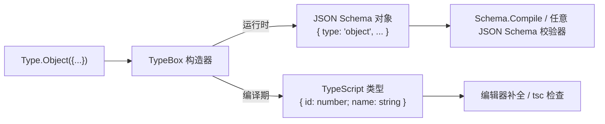

# 深入理解 TypeBox 1.x：一次声明，同时拿到 JSON Schema 和 TypeScript 类型

TypeScript 的类型只存在于编译期，运行时拿不到。想在边界层（HTTP 请求、消息队列、配置文件）校验数据，通常还要再写一份 Schema：JSON Schema、Zod、Yup、Joi，或者其他运行时校验描述。于是同一份契约被拆成两份：一份给类型系统，一份给校验器。两边一旦漂移，bug 就会从缝隙里漏出来。

[TypeBox](https://github.com/sinclairzx81/typebox) 的做法很直接：**用一份表达式，同时产出运行时可用的标准 JSON Schema 和编译期可用的 TypeScript 类型。** 一次声明，两份产物，而且是同一个对象：不需要代码生成、不需要装饰器、不需要额外构建步骤。

> 本文示例基于写作时的 **TypeBox 1.3.6**（1.x 主线）API。1.x 使用新的 npm 包名 `typebox`，面向新一代 TypeScript 编译器，**仅提供 ESM**；仍需要 CJS、或被旧 TS/旧生态包强绑定的项目，可以继续使用 0.x LTS（旧包名 `@sinclair/typebox`，通过 [`sinclair-typebox`](https://github.com/sinclairzx81/sinclair-typebox) 仓库维护）。文末有 1.x vs 0.x 的对照。

---

## 一、先理解心智模型：Schema 就是运行时的值，类型是它的"影子"

大多数校验库把「类型」和「Schema」分成两条独立的线。TypeBox 反过来：

- **运行时**：`Type.String()` 是一个普通对象 `{ type: "string" }`，也就是标准 JSON Schema 片段。
- **编译期**：同一个表达式在 TypeScript 里被推导为 `TString`，通过 `Type.Static<typeof T>` 可以取出对应的 TS 类型 `string`。



一句话：**Schema 是「一等值」，TS 类型是它自动派生出的镜像。** 只要你写好 Schema，类型就白送。

---

## 二、基础构造器：JSON Schema 的类型代数

1.x 把 `Type` 作为主要入口：一个命名空间，所有构造器、类型工具、`Static` 都挂在它下面：

```ts
import Type from 'typebox'

// 定义一条 User 记录：同时得到 JSON Schema + TS 类型
// - Type.Object 描述对象结构
// - 每个字段可以继续用 Type.String / Number / Boolean 等嵌套
const User = Type.Object({
  id: Type.Integer({ minimum: 1 }),
  name: Type.String({ minLength: 1, maxLength: 64 }),
  email: Type.String({ format: 'email' }),
  active: Type.Boolean(),
})

// Type.Static<typeof User> 把 Schema 在编译期"反投影"回 TS 类型
// 等价于：type User = { id: number; name: string; email: string; active: boolean }
type User = Type.Static<typeof User>

console.log(User)
// {
//   type: 'object',
//   properties: {
//     id:     { type: 'integer', minimum: 1 },
//     name:   { type: 'string', minLength: 1, maxLength: 64 },
//     email:  { type: 'string', format: 'email' },
//     active: { type: 'boolean' },
//   },
//   required: ['id', 'name', 'email', 'active'],
// }
```

约定和注意点：

- `Type.Object` 里**所有字段默认都是 required**;要可选包一层 `Type.Optional(...)`。
- 校验约束（`minLength`、`format`、`minimum`……）作为构造器的选项对象传入，直接落到标准 JSON Schema 属性里。对象本身的选项则放在 `Type.Object(fields, options)` 的第二个参数。
- `Type.Integer()` 生成 `{ type: 'integer' }`,`Type.Number()` 生成 `{ type: 'number' }`——JSON Schema 里两者不同,别搞混。
- **0.x → 1.x 的差异**:旧版是 `import { Type, Static } from '@sinclair/typebox'`,`Static` 是独立顶层导出;1.x 全部收敛进 `Type` 命名空间,并改成默认导入。

常用基础构造器一览:

| API | JSON Schema | TS 类型 |
| --- | --- | --- |
| `Type.String()` | `{ type: 'string' }` | `string` |
| `Type.Number()` | `{ type: 'number' }` | `number` |
| `Type.Integer()` | `{ type: 'integer' }` | `number` |
| `Type.Boolean()` | `{ type: 'boolean' }` | `boolean` |
| `Type.Null()` | `{ type: 'null' }` | `null` |
| `Type.Literal('a')` | `{ const: 'a' }` | `'a'` |
| `Type.Array(T)` | `{ type: 'array', items: T }` | `T[]` |
| `Type.Tuple([A, B])` | `{ type: 'array', prefixItems: [...] }` | `[A, B]` |
| `Type.Record(K, V)` | `{ type: 'object', patternProperties: ... }` | `Record<K, V>` |
| `Type.Union([A, B])` | `{ anyOf: [A, B] }` | `A \| B` |
| `Type.Intersect([A, B])` | `{ allOf: [A, B] }` | `A & B` |
| `Type.Optional(T)` | 从 `required` 中移除 | 可选属性 |

---

## 三、`Type.Static` 是怎么做到"零代码生成"的

TypeBox 没有 codegen、没有装饰器、没有 tsc 插件。它靠一个 TypeScript 类型系统的老技巧:**在返回值类型里挂一个从不实际赋值的 phantom 属性**,借助 `unique symbol` 把 TS 类型"藏"在 JSON Schema 对象上。

伪代码大致是这样:

```ts
// 简化示意,展示 TypeBox 的类型技巧
// 真实实现更复杂,但核心思路一致
declare const StaticSymbol: unique symbol

interface TSchema {
  [StaticSymbol]?: unknown  // 永远为 undefined,仅用于承载类型
}

interface TString extends TSchema {
  [StaticSymbol]?: string
  type: 'string'
}

// Static 把 phantom 上挂着的类型抠出来
type Static<T extends TSchema> = NonNullable<T[typeof StaticSymbol]>
```

好处很直接:

- **运行时零成本**:phantom 属性只是类型上的一个签名,真实对象里根本没有这个 key。
- **完全兼容 JSON Schema**:序列化出去就是一份标准 Schema,任何工具都能吃。
- **不需要编译步骤**:普通 `.ts` 文件,`tsc` / `ts-node` / `bun` / `deno` 都直接跑。

对使用者来说,你只需要记住:**写 `Type.Xxx(...)` 得到值,写 `Type.Static<typeof T>` 得到对应的 TS 类型。**

---

## 四、组合与派生:像玩类型代数一样玩 Schema

真实业务里的 Schema 不会都是从零手搓,更多是在既有类型上做变换。TypeBox 把常见 TypeScript 类型变换和类型表达(`Partial`、`Pick`、`Omit`、`KeyOf`、`Interface`……)全都镜像了一份——你在类型层能做的组合,在 Schema 层一样能做。

```ts
import Type from 'typebox'

// 基础实体
const User = Type.Object({
  id: Type.Integer(),
  name: Type.String(),
  email: Type.String({ format: 'email' }),
  password: Type.String({ minLength: 8 }),
})

// 创建用户的输入:去掉 id(服务端生成),同时把 password 保留
// - Type.Omit 从对象中剔除若干字段
const CreateUserInput = Type.Omit(User, ['id'])

// 对外返回:再把 password 去掉
const PublicUser = Type.Omit(User, ['password'])

// 更新场景:所有字段都变成可选
const UpdateUserInput = Type.Partial(Type.Omit(User, ['id']))

// 接口继承式地合并两个对象(相比 Intersect 生成 allOf,Interface 直接得到新对象 Schema)
const AuditFields = Type.Object({
  createdAt: Type.String({ format: 'date-time' }),
  updatedAt: Type.String({ format: 'date-time' }),
})
const UserRow = Type.Interface([User, AuditFields], {})

type CreateUserInput = Type.Static<typeof CreateUserInput>
type UpdateUserInput = Type.Static<typeof UpdateUserInput>
type UserRow = Type.Static<typeof UserRow>
```

关键点:

- `Type.Interface([A, B], {})` 是"扁平继承"——生成的 JSON Schema 是一个新的对象 Schema,而不是 `allOf` 组合。相比 `Type.Intersect`,前者对下游校验器和 OpenAPI 生成器更友好。
- `Type.Partial` / `Type.Required` / `Type.Pick` / `Type.Omit` / `Type.KeyOf` / `Type.Exclude` / `Type.Extract` / `Type.NonNullable`——名字和 TS 内建工具一一对应,语义几乎一致。1.x 还加了 `Type.Capitalize` / `Uncapitalize` / `Uppercase` / `Lowercase` 这类字符串级工具。
- 所有这些工具都是**纯粹的编译期 + 运行时同步变换**:Schema 变形了,派生出来的 TS 类型也跟着变形。**永远不会有两边不一致的问题。**

---

## 五、1.x 的旗舰新特性:`Type.Script` 把 TS 类型源码直接编译成 Schema

组合子写多了还是有点吵。1.x 引入了一个**运行时脚本引擎**:直接给它一段 TypeScript 类型源码字符串,它在运行时把这段类型"解析并求值"成 JSON Schema——同时 TypeScript 的类型层用同一套字符串模板类型引擎把结果反射成 TS 类型。这是 0.x 完全没有的能力。

```ts
import Type from 'typebox'

// 模块:注意这是一个字符串,里面就是普通的 TS 类型语法
// - 运行时:被解析成 JSON Schema 集合
// - 编译期:借助 TypeBox 的类型级解析,推出等价的 TS 类型
const Math = Type.Script(`
  type Vector2 = { x: number, y: number }
  type Vector3 = { x: number, y: number, z: number }
  type Vector4 = { x: number, y: number, z: number, w: number }
`)

// 依赖模块:把上一个 Math 传入作为符号环境
const { Mesh } = Type.Script(Math, `
  type Vertex   = { position: Vector4, normal: Vector3, uv: Vector2 }
  type Geometry = { vertices: Vertex[], indices: number[] }
  type Material = { ambient: Vector4, diffuse: Vector4, specular: Vector4 }
  type Mesh     = { geometry: Geometry, material: Material }
`)

// 运行时反射:Mesh 就是 JSON Schema 对象,可以任意 `.properties.x` 走下去
Mesh.properties.geometry.properties.vertices.items.properties.position.properties.x

// 静态推断:同一段字符串,类型层也已经推导好了 TS 类型
function render(mesh: Type.Static<typeof Mesh>) {
  mesh.geometry.vertices[0].position.x
  mesh.material.diffuse.x
}
```

`Type.Script` 支持的语言子集比 0.x 时代丰富得多:条件类型、映射类型、索引访问、泛型、分布式条件都在官方支持范围内。它的目标是让常见 TS 类型表达能在运行时同构求值,但不要把它当成完整 TypeScript 编译器;复杂边缘类型仍要以实际支持和测试结果为准。官方还提供了 VS Code 语法高亮插件(`typebox-script`),让字符串里的 TS 语法也有着色。

要不要用它,取决于口味:

- **组合子(`Type.Object(...)`)**:类型检查更早、代码补全更强、重构工具更认得,是绝大多数场景的默认。
- **`Type.Script`**:适合 Schema 高度递归、字段量大、或希望"贴近手写 TS 类型"的场景;缺点是字符串里没有 IDE 层面的字段补全,重构工具也不认。

---

## 六、`Value` 命名空间:开箱即用的运行时能力

有了 Schema,总要拿它做点事。TypeBox 把不依赖 JIT 的运行时工具挂在了 `typebox/value` 上,按需导入:

```ts
import Type from 'typebox'
import Value from 'typebox/value'

const Config = Type.Object({
  host: Type.String({ default: '127.0.0.1' }),
  port: Type.Integer({ minimum: 1, maximum: 65535, default: 8080 }),
  debug: Type.Boolean({ default: false }),
})

// 1) 校验:返回 boolean
Value.Check(Config, { host: 'x', port: 80, debug: true }) // true

// 2) 拿到详细错误:惰性生成的迭代器
for (const err of Value.Errors(Config, { host: 'x', port: -1 })) {
  console.log(err.path, err.message)
  // /port  Expected integer to be greater or equal to 1
}

// 3) 用 default 注解补默认值
Value.Default(Config, {}) // { host: '127.0.0.1', port: 8080, debug: false }

// 4) 尽力"强转"一个值:能改的字段按 Schema 类型强修(注意 1.x 里叫 Convert,不再是 Cast)
Value.Convert(Config, { host: 'x', port: '80', debug: false })
// { host: 'x', port: 80, debug: false }

// 5) 剔除 Schema 里没定义的多余字段
Value.Clean(Config, { host: 'x', port: 80, debug: false, extra: 'gone' })
// { host: 'x', port: 80, debug: false }

// 6) 修补:数据结构不匹配时按 Schema 的默认结构补齐,常用于版本迁移
Value.Repair(Config, { port: 80 })
// { host: '127.0.0.1', port: 80, debug: false }

// 7) 深拷贝、相等、Hash、Diff/Patch、Pointer(JSON Pointer)……
Value.Clone(obj)
Value.Equal(a, b)
Value.Hash(obj)
Value.Diff(a, b)
Value.Patch(a, edits)
Value.Pointer.Get(obj, '/a/b/0')
```

一条链路你就能拼出常见的"入站清洗":先 `Clean` 剔多余字段,再 `Default` 补默认值,再 `Convert` 修类型,最后 `Check` 校验。**全程零依赖,不用装 Ajv。** 注意不要把 `Convert` 当成默认值填充工具；结构缺失和默认值补齐交给 `Default` / `Repair` 更清晰。

> 命名迁移提示:0.x 里的 `Value.Cast` 在 1.x 拆成了 `Value.Convert`(仅类型强转)+ `Value.Repair`(结构层修补)两个语义更清晰的函数。

---

## 七、`typebox/schema`:把 Schema JIT 编译成校验器

上面的 `Value.Check` 走的是**解释执行**——每次调用都要遍历 Schema 树,通用但慢。生产环境的热点路径更适合 `typebox/schema` 里的 JIT 编译器:**把 Schema 编译成一段专属的 JavaScript 校验函数**,通过 `new Function` 生成,速度贴近手写代码。

```ts
import Type from 'typebox'
import Schema from 'typebox/schema'

const User = Type.Object({
  id: Type.Integer(),
  name: Type.String({ minLength: 1 }),
  email: Type.String(),
})

// 一次性编译,后续复用
// - Check(v):最快的路径,直接布尔返回
// - Parse(v):校验并把值原样返回(类型收窄到 Static<typeof User>);失败抛异常
// - 也接受纯 JSON Schema 对象,不限于 TypeBox 构造的 Schema
const V = Schema.Compile(User)

V.Check({ id: 1, name: 'ada', email: 'ada@example.com' })   // true
const parsed = V.Parse({ id: 1, name: 'ada', email: 'ada@example.com' })
// parsed 的类型就是 { id: number; name: string; email: string }
```

三个要点:

- **不需要 Ajv**——`Schema.Compile` 自己就是校验器,产物不依赖任何运行时包。
- **JIT 受限环境自动回退**:Cloudflare Workers 这类禁 `new Function` 的运行时,`Schema.Compile` 会自动走动态校验路径,同一份调用代码无需改动。
- **性能**:官方 benchmark 里编译速度比 Ajv 8 快 5–20 倍,校验速度普遍快 1.5–2 倍(Union 类差距更大)。数字仅供参考,实际请以你自己的负载测量为准。
- **覆盖度**:JSON Schema Draft 3 → 2019-09 → 2020-12 → JSON Schema v1(next),官方公布了完整的一致性测试通过率表。

---

## 八、和生态怎么接:Fastify / Elysia / OpenAPI

因为 TypeBox 的产物就是标准 JSON Schema,它天然是"通用件":

- **Fastify**:`@fastify/type-provider-typebox` 提供 `TypeBoxTypeProvider`,直接把 Schema 挂到路由上,请求/响应自动校验、handler 里的 `request.body` 已经是精确 TS 类型。
- **Elysia**(Bun 生态):内建 `t` 就是 TypeBox 的重导出,`t.Object({...})` 用法完全一致。
- **OpenAPI**:因为是纯 JSON Schema,可以直接塞进 OpenAPI 3.1 的 `components.schemas`,或者用 `@fastify/swagger` 自动汇总。

一个 Fastify 端到端示例:

```ts
import Fastify from 'fastify'
import { Type } from '@fastify/type-provider-typebox'
import type { TypeBoxTypeProvider } from '@fastify/type-provider-typebox'

const app = Fastify().withTypeProvider<TypeBoxTypeProvider>()

// 一次声明,请求体校验 + handler 类型推导 + Swagger 文档全打通
const CreateUser = Type.Object({
  name: Type.String({ minLength: 1 }),
  email: Type.String(),
})

app.post('/users', {
  schema: {
    body: CreateUser,
    response: {
      200: Type.Object({ id: Type.Integer(), name: Type.String() }),
    },
  },
  handler: async (req) => {
    // req.body 的类型就是 Type.Static<typeof CreateUser>
    // 到这里 req.body 已经通过 Fastify 内置 Ajv 校验过了
    return { id: 1, name: req.body.name }
  },
})
```

**Schema 只在一处出现;类型、校验、文档、错误响应,全部由它派生。** 这是 TypeBox 相较 Zod 生态最大的差异化——Zod v4 已经内建 JSON Schema 转换,但它仍是"从 Zod 转出去";TypeBox 的源码对象本身就是 JSON Schema。

> 生态兼容说明:新版 `@fastify/type-provider-typebox` 已面向 `typebox` 1.x;如果你还在 Fastify 4 或旧 provider 版本,通常仍会对应 `@sinclair/typebox` 0.x。选型时先看 `peerDependencies`,不要让 provider 和 TypeBox 主包跨大版本混用。

---

## 九、`Type.Codec` / `Type.Refine`:编解码通道与自定义精化

网络与存储层里到处是"看着像但不是"的类型:日期是字符串、金额是字符串、布尔可能是 `"true"`。1.x 把这层翻译写进 Schema 用 `Type.Codec`(0.x 里叫 `Type.Transform`):

```ts
import Type from 'typebox'
import Value from 'typebox/value'

// 把 ISO 8601 字符串在边界处翻译成 Date,反向再翻译回字符串
// - Decode:外部 -> 内部
// - Encode:内部 -> 外部
const IsoDate = Type.Codec(Type.String({ format: 'date-time' }))
  .Decode((s) => new Date(s))
  .Encode((d) => d.toISOString())

const Event = Type.Object({
  id: Type.Integer(),
  happenedAt: IsoDate,
})

// 类型层:happenedAt 已经是 Date 而不是 string
type Event = Type.Static<typeof Event>

const raw = { id: 1, happenedAt: '2026-07-13T09:32:16Z' }

const decoded = Value.Decode(Event, raw)
// { id: 1, happenedAt: Date(...) }

const encoded = Value.Encode(Event, decoded)
// { id: 1, happenedAt: '2026-07-13T09:32:16.000Z' }
```

除了 `Codec` 的双向翻译,1.x 还提供了单向的 `Type.Decode(T, fn)` / `Type.Encode(T, fn)`,以及**任意逻辑的运行时精化** `Type.Refine`:

```ts
// 用一个校验回调做"JSON Schema 表达不出来的"约束
// - Refine 只在运行时生效,不会写进 JSON Schema
const EvenInt = Type.Refine(
  Type.Integer(),
  (n) => n % 2 === 0,
  (n) => `Expected even integer, got ${n}`,
)

Value.Check(EvenInt, 4) // true
Value.Check(EvenInt, 5) // false
```

`Codec` 的价值在于:**你的领域模型只写"干净"类型,`Decode/Encode` 负责在边界上完成翻译。** 避免在业务代码里到处散落 `new Date(x.happenedAt)`。

---

## 十、递归结构:`Type.Cyclic` + `Type.Ref`

真实业务里避不开的递归结构(树、菜单、评论),1.x 用 `Cyclic` + `Ref` 表达一组可互相引用的定义(0.x 里的 `Type.Recursive` 已被替代):

```ts
import Type from 'typebox'

// 命名 + 引用:大结构复用同一个子 Schema
// - Type.Ref('Address') 生成 { $ref: 'Address' }
const Address = Type.Object(
  { city: Type.String(), zip: Type.String() },
  { $id: 'Address' },
)
const Company = Type.Object({
  name: Type.String(),
  address: Type.Ref('Address'),
})

// 递归结构:Cyclic($defs, $ref) 建立一组"互引用"的定义集合
// - 内部用 Type.Ref('Node') 指回自身
const Tree = Type.Cyclic(
  {
    Node: Type.Object({
      id: Type.Integer(),
      children: Type.Array(Type.Ref('Node')),
    }),
  },
  'Node',
)
type Tree = Type.Static<typeof Tree>

// 极端情况的"逃生舱":当组合子表达不出你想要的 JSON Schema 时
// 手写 Schema + 显式指定 TS 类型参数,类型一致性由调用方保证
const AnyJson = Type.Unsafe<Record<string, unknown>>({
  type: 'object',
  additionalProperties: true,
})
```

`Type.Unsafe` 是最后的救命稻草:某些 OpenAPI 扩展或非标属性无法用组合子表达时,直接手写 JSON Schema,配合一个显式的 TS 类型参数——**编译期看到的类型和运行时的 Schema 之间的一致性,由你自己保证**。别滥用。

---

## 十一、1.x 与 0.x 的差异一览

如果你的项目还在 `@sinclair/typebox` 0.x 上、正在评估要不要升 1.x,下面这张表可以先扫一眼:

| 维度 | 1.x(`typebox`) | 0.x LTS(`@sinclair/typebox`) |
| --- | --- | --- |
| npm 包名 | `typebox` | `@sinclair/typebox` |
| 仓库 | `sinclairzx81/typebox` | `sinclairzx81/sinclair-typebox` |
| 模块格式 | **仅 ESM** | ESM + CJS |
| TypeScript 版本 | 6.0 – 7.0+ | 5.0 – 6.0 |
| 主入口 | `import Type from 'typebox'`(默认导出) | `import { Type, Static } from '@sinclair/typebox'` |
| `Static` | `Type.Static<typeof T>` | 顶层 `Static<typeof T>` |
| 运行时脚本 | **`Type.Script(\`type X = ...\`)`(新)** | 不支持 |
| 编解码 | `Type.Codec(T).Decode(...).Encode(...)` | `Type.Transform(T).Decode(...).Encode(...)` |
| 递归 | `Type.Cyclic($defs, $ref)` + `Type.Ref(...)` | `Type.Recursive(Self => ...)` |
| 精化 | `Type.Refine(T, check, error?)`(新) | 无一等公民,靠自定义关键字 |
| JIT 编译器 | `import Schema from 'typebox/schema'` → `Schema.Compile(T)` | `import { TypeCompiler } from '@sinclair/typebox/compiler'` → `TypeCompiler.Compile(T)` |
| 值工具 | `import Value from 'typebox/value'`(命名空间) | `import { Value } from '@sinclair/typebox/value'` |
| Cast 类工具 | `Value.Convert` + `Value.Repair`(拆开) | `Value.Cast`(合并) |
| Fastify 官方 provider | 新版支持 1.x,旧版 provider 仍对应 0.x | 成熟支持 |
| JSON Schema 版本 | 覆盖到 2020-12 和 v1(next) | 覆盖到 2020-12 |

判断依据:

- **主要在 Bun/Deno/纯 ESM 环境,可以升 TS 6+,想用 `Type.Script` 或更新的 JSON Schema 能力**——上 1.x。
- **CJS 依赖多、Fastify 生态深度绑定、TS 版本升级窗口未到**——留在 0.x LTS,官方仍在维护。

---

## 十二、和 Zod 深度对比

Zod 是 TypeScript 生态里目前用户量最大的运行时类型库,和 TypeBox 常被拿来一起选。不是踩一捧一,只谈定位差异。

### 12.1 API 风格并排对照

同一份 `User` Schema,两边写起来长这样:

```ts
// TypeBox 1.x —— 函数式、Schema 就是普通对象
import Type from 'typebox'

const User = Type.Object({
  id: Type.Integer({ minimum: 1 }),
  name: Type.String({ minLength: 1, maxLength: 64 }),
  email: Type.String({ format: 'email' }),
  tags: Type.Array(Type.String()),
  role: Type.Union([Type.Literal('admin'), Type.Literal('user')]),
})
type User = Type.Static<typeof User>

// 序列化出去就是标准 JSON Schema
JSON.stringify(User)
```

```ts
// Zod v4 —— 链式、Schema 是私有对象
import { z } from 'zod'

const User = z.object({
  id: z.number().int().min(1),
  name: z.string().min(1).max(64),
  email: z.email(),                     // v4 提到顶层,不再是 z.string().email()
  tags: z.array(z.string()),
  role: z.enum(['admin', 'user']),
})
type User = z.infer<typeof User>

// 想拿到 JSON Schema：v4 内置 z.toJSONSchema(User)
// 更早的版本需要 zod-to-json-schema 桥接
```

两边共同点:一份声明,TS 类型自动派生。差异点:

- **TypeBox 的产物直接就是标准 JSON Schema**,可以塞进任何 JSON Schema 生态(Ajv、OpenAPI 3.1、跨语言消费者)。
- **Zod 的产物是它自己的 Schema 对象**,`z.infer` 也是它自己的类型工具。想跨界(出 OpenAPI、跨语言)要走转换;v4 起把 `toJSONSchema` 内建了,情况好很多,但它仍是"从 Zod 转出去",不是以 JSON Schema 作为源码。

### 12.2 特性对照表

| 维度 | TypeBox 1.x | Zod v4 |
| --- | --- | --- |
| Schema 本体 | **标准 JSON Schema 对象** | 私有类实例(带 `_def`) |
| TS 类型派生 | `Type.Static<typeof T>` | `z.infer<typeof T>` |
| JSON Schema 输出 | 天然就是,零成本 | v4 内建 `z.toJSONSchema`;v3 需 `zod-to-json-schema` |
| OpenAPI 集成 | 一等公民,直接塞 `components.schemas` | 需要 `@asteasolutions/zod-to-openapi` 等胶水 |
| 校验性能(JIT) | **极快**(见下表) | 中等偏快(v4 相比 v3 有显著提升) |
| Bundle 体积 | 后端通常无感;浏览器/Edge 要实测打包结果 | v4 拆出 `zod/mini`,更适合严控体积的前端/Edge 场景 |
| API 风格 | 函数式:`Type.String({ minLength: 1 })` | 链式:`z.string().min(1)` |
| 错误信息 | JSON Schema 风格,机器可读、含 `path` | 更"人话",默认信息更直观 |
| 精化/自定义校验 | `Type.Refine(T, fn)` | `.refine(fn)` / `.superRefine`(更成熟) |
| 转换/编解码 | `Type.Codec(T).Decode(...).Encode(...)` | `.transform(fn)` / v4 `z.codec` |
| 递归类型 | `Type.Cyclic + Ref` | `z.lazy(() => ...)` |
| 判别联合 | `Type.Union([...])`(靠 `oneOf` 或 `discriminator` 关键字) | `z.discriminatedUnion('tag', [...])`(一等公民) |
| 表单/前端 DX | 一般 | 更强,链式对表单场景友好 |
| React 生态 | 需自己接 | React Hook Form、tRPC、Next.js Actions 默认位 |
| 后端框架 | Fastify、Elysia、TypeBox 系原生 | tRPC、Hono、NestJS 生态更常见 |
| 数据修补/迁移 | `Value.Convert` / `Value.Repair` / `Value.Clean` | 主要靠 `.transform` 自己写 |

### 12.3 性能:数字层面到底差多少

TypeBox 官方 benchmark(见项目 README)对比 Ajv 8:

- **编译速度**:`Object_Vector3` 40.2K ops/s vs Ajv 3.2K ops/s——**约 12 倍**;简单类型(Boolean/String)约 6–12 倍。
- **校验速度**:`Union_Or` 95M ops/s vs Ajv 7.9M ops/s——**约 12 倍**(Union 是差距最大的场景);Object/Array 类普遍 **1.5–2 倍**;基础类型双方都逼近了 V8 的天花板,差距不大。

对 Zod 的对比,可以参考社区常年在维护的 [`moltar/typescript-runtime-type-benchmarks`](https://github.com/moltar/typescript-runtime-type-benchmarks)(数字随版本浮动,以下仅作数量级参考):

- **纯校验(safe parse)**:TypeBox JIT ≫ Zod v3。Zod v3 在同类库里长期排后段,主要是每次校验都要遍历一次它的 schema 类实例。
- **Zod v4** 做了大量优化(重写了核心执行器,链式对象也做了内联);根据官方发布说明和社区跑分,v4 相比 v3 **快 3–14 倍**(取决于场景),把差距明显收窄了。
- **`zod/mini`**:v4 附带的轻量版子集,牺牲部分链式糖换体积和速度,更适合 edge/浏览器场景;但它不是完整 Zod API 的等价替换,迁移前要看实际用到哪些方法。
- **量级结论**:即便 Zod v4,**热点路径的绝对性能仍略输 TypeBox JIT**——因为 TypeBox 把 Schema 直接编译成了一段专属的手写风格 JS,天花板更高;但 Zod v4 已经足够快,对绝大多数 Web 后端不构成瓶颈。

如果你的服务是**高 QPS 的网关/校验中间件**,`Schema.Compile` 的绝对性能是硬指标——选 TypeBox。如果是普通业务后端或前端表单,两者都在"够用"的一侧。

### 12.4 生态站位

站位差异比性能差异更影响选型:

- **Zod 的天然生境**:tRPC(默认就是 Zod)、Next.js Server Actions、React Hook Form、Astro Actions、Hono、NestJS(pipe)、AI SDK(结构化输出)——凡是"TypeScript 优先、几乎不出 TS 生态"的地方,Zod 是默认选项。
- **TypeBox 的天然生境**:Fastify(官方 provider)、Elysia(直接内建 `t = TypeBox`)、需要出 OpenAPI 3.1 的 REST 服务、跨语言消费的 gRPC/HTTP 网关、高性能校验中间件。

### 12.5 决策树

按顺序自问,大概率能定下来:

1. **要不要出 JSON Schema / OpenAPI 3.1 给非 TS 消费者用?**——要 → TypeBox。
2. **主要生态是 tRPC / Next.js / React 表单吗?**——是 → Zod(几乎所有周边工具默认就是 Zod)。
3. **是校验密集型的高 QPS 服务?**——是 → TypeBox `Schema.Compile`。
4. **在 Fastify / Elysia 上做后端?**——Elysia 直接用 TypeBox;Fastify 5 + 新版 `@fastify/type-provider-typebox` 可直接走 1.x,Fastify 4 或旧 provider 则继续用 0.x LTS。
5. **重度依赖表单 DX、错误信息给终端用户看?**——Zod 的默认体验更好。
6. **两个都行?**——按团队已有栈继续,不要为了"更好"而迁移;一致性比选型差异更重要。

小结:**TypeBox 是「以 JSON Schema 为中心」的选择,Zod 是「以 TypeScript DX 为中心」的选择。** 定位不同,不完全可替代。

---

## 十三、几个常见陷阱

- **`Object` 字段默认全 required**:忘了包 `Type.Optional`,PATCH 类接口会天天报错。
- **`Type.Number` vs `Type.Integer`**:JSON Schema 里 `number` 允许小数;要整数用 `Type.Integer`。
- **`additionalProperties` 默认允许**:TypeBox 生成的对象 Schema 默认不禁多余字段,大多数校验器(包括 Ajv 默认配置)都会放行。要严格,加 `{ additionalProperties: false }`,或走 `Value.Clean`。
- **`format` 需要确认校验器支持**:`Type.String({ format: 'email' })` 会把 `format` 写进 Schema,但具体是否校验、支持哪些格式,取决于你使用的编译器/Ajv 配置。接 Fastify/Ajv 时通常要配好 `ajv-formats` 或对应的 TypeBox format 注册。
- **`Interface` vs `Intersect`**:需要扁平继承对象时优先用 `Type.Interface([A, B], {})`;`Intersect` 会生成 `allOf`,某些下游生成器/校验器处理不佳。
- **`Schema.Compile` 与 CSP**:JIT 会用 `new Function`;严格 CSP 环境下 1.x 会自动回退到动态校验,但性能会下降,提前评估。
- **`Type.Script` 字符串没有 IDE 补全**:重构工具认不到字符串内部的字段名,重命名要小心;高变动的核心 Schema 用组合子写更安全。
- **递归类型的 `$id` 冲突**:多个 `Ref` 共存时,`$id` 必须全局唯一,否则外部校验器会报错。
- **`Type.Static<typeof T>` 只是"类型影子",不是运行时"实例"**:只能用在类型位置,写在值位置会报错。
- **仅 ESM**:1.x 不再输出 CJS。CommonJS 项目要么迁 ESM,要么留在 0.x LTS。

---

## 十四、一份速查清单

用 TypeBox 前后可以按这几条自检:

1. Schema 是不是**单一事实来源**?TS 类型都通过 `Type.Static` 派生,而不是手写?
2. 需要**双向翻译**(如 `Date ↔ string`)的字段,用了 `Type.Codec` 而不是在业务里手动转?
3. 需要**运行时约束**(JSON Schema 表达不出的)时用了 `Type.Refine`,而不是散落在业务代码里?
4. 热点路径是否用了 `Schema.Compile` 提前编译,而不是每次都 `Value.Check`?
5. 对外接口(HTTP / 消息)是否直接把 TypeBox Schema 挂进 Fastify / Elysia / OpenAPI,而不是再手抄一份?
6. 组合派生优先用 `Pick` / `Omit` / `Partial` / `Interface`,而不是重新构造?
7. 严格边界处是否禁了 `additionalProperties`,或者走了 `Value.Clean`?
8. 用了 `Type.Unsafe` 的地方,有没有留注释说明"这里的类型一致性靠人肉保证"?
9. 目标运行时是否允许 `new Function`?否则做好回退规划。
10. 依赖的生态(Fastify provider 等)是否已经支持 1.x?没就先锁 0.x。

---

## 结论

TypeBox 的核心洞察很简单:**JSON Schema 本身就是一门足够表达的"类型 DSL",与其再发明一门,不如把 TypeScript 类型系统投影到它上面。** 一次声明,同时得到:

- **运行时**:一份标准 JSON Schema,给 `Schema.Compile`、Ajv、Fastify、OpenAPI、任意跨语言消费者。
- **编译期**:一个精确的 TypeScript 类型,给 IDE、tsc、handler 里的自动补全。

1.x 在这条路上又往前走了一步:

- **`Type.Script`** 让 TS 类型源码本身也成为运行时可执行的一等值;
- **`Codec` / `Refine`** 让编解码和精化成为 Schema 的一等公民;
- **`Schema.Compile`** 把 JIT 编译器收敛为一个开箱即用的入口,并在 JIT 受限环境自动优雅降级;
- **单文件默认导出** + `Type.Static` 命名空间化,让 API 表面更小、更聚合。

如果你的系统里 Schema 已经是一等公民(HTTP API、事件总线、配置)、你希望它同时也是**类型系统的一等公民**——TypeBox 1.x 是当前 TypeScript 生态里最贴近这个目标的方案。仍需 CJS/更旧 TS 的项目,0.x LTS 也依然被认真维护。
